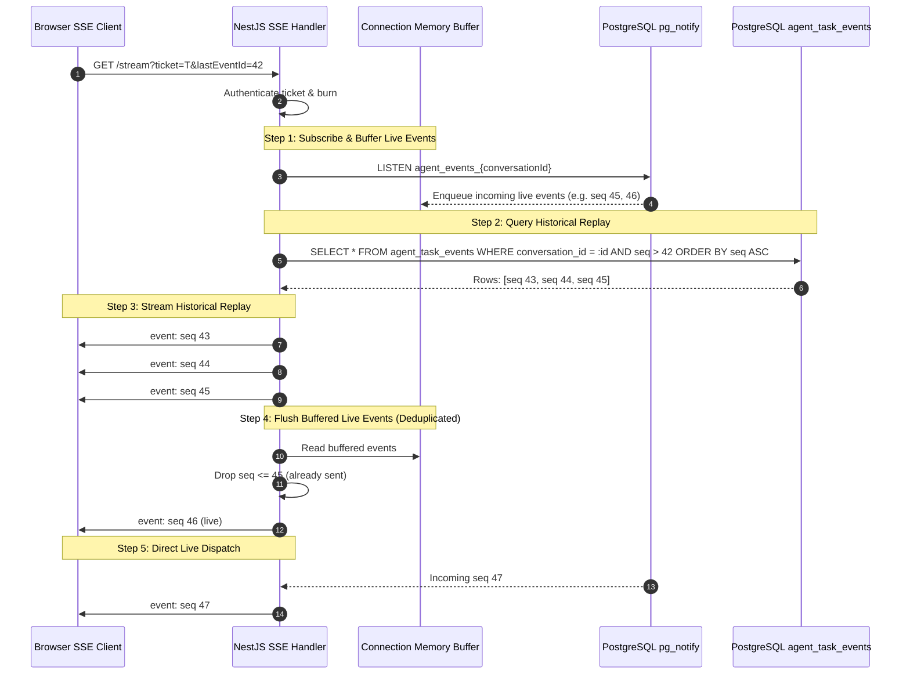
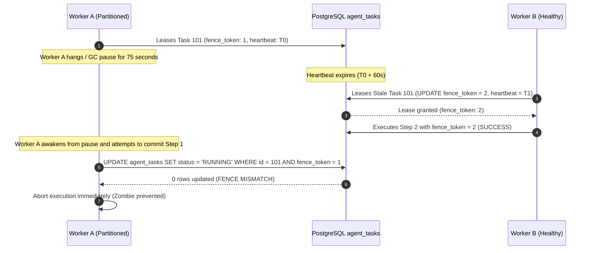
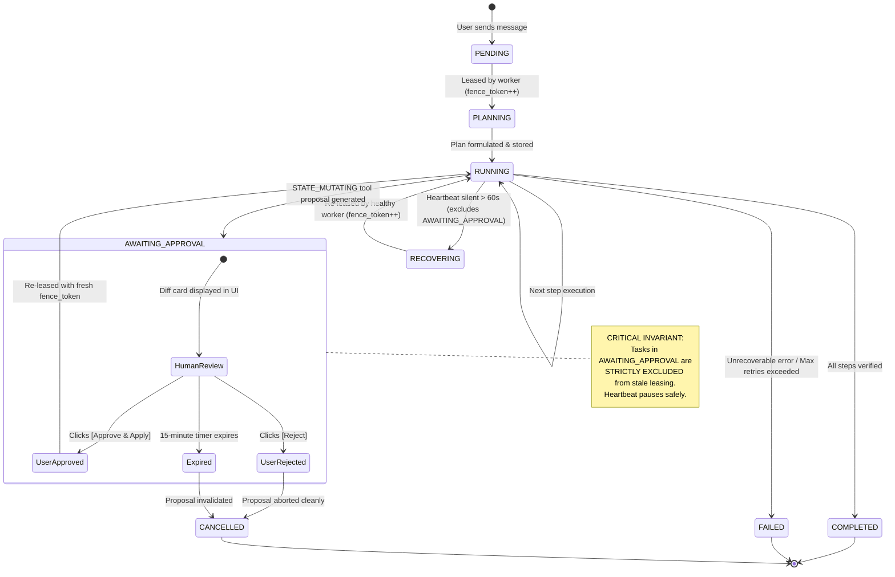
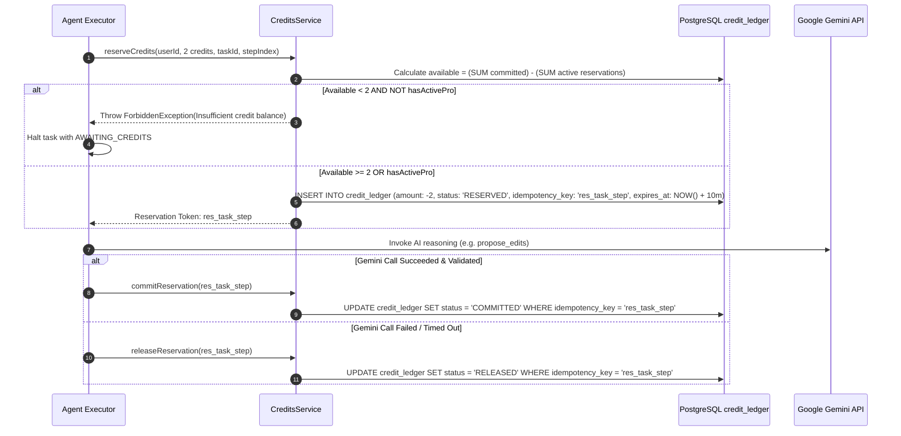

# HyperResume — Agentic AI Career Assistant Architecture
## Technical Blueprint & Distributed Execution Specification (Revision 2.0)

**Document Version:** 2.0.0 (Security & Consistency Revision)  
**Status:** IMPLEMENTATION-READY ARCHITECTURAL BLUEPRINT  
**Target Platform:** HyperResume Monorepo (Next.js 16.4.6 App Router + NestJS 12.0.1 + PostgreSQL 14+)  
**AI Foundation:** Google Gemini Native Function Calling (`gemini-3.1-flash-lite`)  
**Design Reference:** Rezi AI Resume Agent Model with Human-In-The-Loop Safety  

---

## 1. Architectural Decisions & Status

| Decision ID | Area | Selected Architecture | Status | Justification |
| :--- | :--- | :--- | :--- | :--- |
| **ADR-01** | **AI Framework** | **Native Gemini Function Calling over REST** | `[APPROVED]` | 3rd-party agent frameworks (LangChain, CrewAI) introduce ~45MB of dependencies, break NestJS ESM resolution (`.js` extension enforcement), and add debugging opacity. Native Gemini REST API supports `tools: [{ functionDeclarations }]` directly with zero added libraries. |
| **ADR-02** | **Communication** | **Server-Sent Events (SSE) + Single-Use Ticket Auth + PostgreSQL LISTEN/NOTIFY** | `[APPROVED]` | Solves EventSource header limitations via short-lived signed tickets; prevents replay/live race conditions; enables multi-instance PM2/container scaling via PostgreSQL `pg_notify` without requiring Redis. |
| **ADR-03** | **Persistence** | **PostgreSQL 14+ with TypeORM** | `[APPROVED]` | Leverages existing database and TypeORM schema. Guarantees ACID transactional boundaries across task execution, credit reservations, and resume updates. |
| **ADR-04** | **Execution Engine** | **PostgreSQL-Backed Durable Worker with Lease Fencing Tokens** | `[APPROVED]` | Interactive workload (dozens to hundreds of concurrent tasks) does not justify Redis/BullMQ infrastructure overhead. Row leasing (`FOR UPDATE SKIP LOCKED`) with monotonically increasing `fence_token` guarantees 100% crash durability and prevents zombie worker split-brain writes. |
| **ADR-05** | **Approval Model** | **Strict Human-In-The-Loop (HITL) with Cryptographic Proposal Hashing** | `[APPROVED]` | Proposals are bound to `proposal_hash` (SHA-256), `user_id`, `task_id`, `resume_id`, and `expected_resume_version` with a 15-minute single-use expiry. The server applies only the exact approved server-staged payload. |
| **ADR-06** | **Permission Matrix** | **4-Tier Model: READ_ONLY, AI_ANALYSIS, SAFE_MUTATING, STATE_MUTATING** | `[APPROVED]` | Resolves the approval contradiction by establishing `SAFE_MUTATING` for additive operations (`save_job_to_tracker`, `create_resume`) while enforcing mandatory approval on `STATE_MUTATING` operations. |
| **ADR-07** | **Credit Billing** | **Two-Phase Credit Reservation Lifecycle (Reserve -> Commit / Release)** | `[APPROVED]` | Prevents concurrent overspending by holding credits prior to LLM invocation, committing only upon verified output, and auto-releasing on failure or timeout. |
| **ADR-08** | **Career Vault Memory**| **Explicit Opt-In + Separation of Detected vs. Verified Skills** | `[APPROVED]` | Long-term AI memory defaults to `ai_memory_consent = false`. Skills are segregated into `detected_skills` (AI-extracted) and `verified_skills` (candidate-confirmed). AI cannot independently verify claims. |
| **ADR-09** | **Task Spending Cap** | **Configurable Task Spending Cap (Default: 6 Credits)** | `[REQUIRES USER DECISION]` | Enforces hard ceiling on runaway multi-step LLM loops. User can configure limit in settings or backend env (`AGENT_MAX_TASK_CREDITS`). |
| **ADR-10** | **Lease Expiry Duration**| **Worker Heartbeat (5s) & Lease Expiry (60s)** | `[REQUIRES USER DECISION]` | Heartbeat interval set to 5s; stale lease recovery threshold set to 60s. Tasks in `AWAITING_APPROVAL` are strictly excluded from stale recovery. |

---

## 2. System Architecture Overview

```mermaid
flowchart TD
    subgraph Client["Next.js 16.4.6 Frontend"]
        SplitUI["Split-Screen Resume Workspace<br/>/app/resumes/[id]"]
        AgentChat["AgentChatPanel (40% width)<br/>Execution Progress & Action Cards"]
        ResumeCanvas["Live ATS Resume Canvas (60% width)<br/>Visual Green/Red Diff Overlays"]
        SSEClient["SSE Connection Manager<br/>EventSource with Replay Reconnect"]
    end

    subgraph Gateway["NestJS 12 API Gateway & Security"]
        AuthGuard["JwtAuthGuard (Bearer JWT)"]
        TicketGuard["SseTicketGuard (Single-Use Signed Ticket)"]
        TenantGuard["TenantIsolationGuard (Enforces userId)"]
        RateLimiter["AgentRateLimiter (Per-user sliding window)"]
    end

    subgraph AgentCore["Agent Orchestration Engine (backend/src/agent)"]
        AgentCtrl["AgentController<br/>POST /messages, POST /stream-ticket, GET /stream"]
        AgentService["AgentService<br/>Task Coordinator & SSE Event Dispatcher"]
        AgentPlanner["AgentPlannerService<br/>Intent & DAG Decomposition"]
        AgentExecutor["AgentExecutorService<br/>Tool Dispatcher & HITL Approval Gate"]
        ToolRegistry["ToolRegistryService<br/>15 Typed Tool Definitions & JSON Schemas"]
        DurableWorker["DurableTaskWorker<br/>Background Leasing, Fencing Tokens & Heartbeats"]
    end

    subgraph ExistingServices["Reused Domain Services"]
        ResumesSvc["ResumesService<br/>(getResume, updateResume, createVersion)"]
        AtsEngine["ats-audit-engine.ts<br/>(5-dimension deterministic scorer)"]
        JobMatchSvc["JobMatchingService<br/>(matchRequirements, gap analysis)"]
        JobDiscoverySvc["JobDiscoveryService<br/>(Ashby, Greenhouse, Lever search)"]
        CoverLetterSvc["CoverLettersService<br/>(generate, update)"]
        InterviewsSvc["InterviewsService<br/>(sessions, questions, turns)"]
        CreditsSvc["CreditsService<br/>(atomic credit reservation & commit)"]
        Validator["FactualIntegrityValidator<br/>(metric verification & evidence provenance)"]
    end

    subgraph Persistence["PostgreSQL 14+ Database"]
        PG_Agent[(Agent Tables<br/>conversations, messages, tasks, tool_executions, task_events, tickets)]
        PG_Domain[(Domain Tables<br/>users, resumes, versions, job_matches, credit_ledger, profiles)]
        PG_PubSub["PostgreSQL LISTEN / NOTIFY<br/>(pg_notify for multi-instance PM2/cluster events)"]
    end

    subgraph External["External Services"]
        GeminiAPI["Google Gemini API<br/>(gemini-3.1-flash-lite via REST FC)"]
    end

    SplitUI --> AgentChat
    SplitUI --> ResumeCanvas
    AgentChat --> SSEClient
    AgentChat --> Gateway
    Gateway --> AuthGuard --> TenantGuard --> RateLimiter --> AgentCtrl
    SSEClient -.->|1. POST /stream-ticket| AgentCtrl
    SSEClient -.->|2. GET /stream?ticket=... (SSE)| TicketGuard --> AgentCtrl
    AgentCtrl --> AgentService
    AgentService --> DurableWorker
    DurableWorker --> AgentPlanner
    DurableWorker --> AgentExecutor
    AgentPlanner --> GeminiAPI
    AgentExecutor --> ToolRegistry
    AgentExecutor --> GeminiAPI
    ToolRegistry --> ResumesSvc
    ToolRegistry --> AtsEngine
    ToolRegistry --> JobMatchSvc
    ToolRegistry --> JobDiscoverySvc
    ToolRegistry --> CoverLetterSvc
    ToolRegistry --> InterviewsSvc
    ToolRegistry --> CreditsSvc
    AgentExecutor --> Validator
    DurableWorker --> PG_Agent
    DurableWorker --> PG_PubSub
    PG_PubSub -.->|LISTEN event| AgentService
    ResumesSvc --> PG_Domain
    CreditsSvc --> PG_Domain
```

---

## 3. Server-Sent Events (SSE) Protocol & Multi-Instance Architecture

### 3.1 Overcoming Browser EventSource Authentication Limitations
Standard browser `new EventSource(url)` does NOT permit sending custom HTTP headers (such as `Authorization: Bearer <token>`). Passing raw JWTs in query parameters exposes tokens in access logs, proxy caches, and browser history.

#### The Solution: Short-Lived Single-Use Ticket Exchange
1. **Ticket Request:** Client issues an authenticated POST request:
   ```http
   POST /api/v1/agent/conversations/:id/stream-ticket HTTP/1.1
   Authorization: Bearer <jwt>
   ```
2. **Ticket Generation & Persistence:** Server generates a cryptographically secure random token (32 bytes), computes its SHA-256 hash, and stores it in table `agent_stream_tickets`:
   ```sql
   INSERT INTO agent_stream_tickets (ticket_hash, user_id, conversation_id, expires_at)
   VALUES (:hash, :userId, :conversationId, NOW() + INTERVAL '30 seconds');
   ```
3. **SSE Connection:** Client establishes EventSource with the temporary ticket:
   ```javascript
   const es = new EventSource(`/api/v1/agent/conversations/${conversationId}/stream?ticket=${ticket}&lastEventId=${lastId}`);
   ```
4. **Validation & Single-Use Burning:** Server hashes incoming ticket, queries `agent_stream_tickets`, verifies `expires_at > NOW()`, burns the ticket (`DELETE FROM agent_stream_tickets WHERE ticket_hash = :hash`), and establishes the stream.

### 3.2 Preventing Replay/Live Subscription Race Conditions
In distributed systems, subscribing to live events before or after querying historical events can cause duplicate deliveries or dropped events.



### 3.3 Multi-Instance PM2 / Container Scaling via PostgreSQL `LISTEN / NOTIFY`
When running multiple PM2 workers or Kubernetes pods:
- Instance A leases and executes the task.
- Instance B holds the user's open SSE connection.
- When Instance A records an event in `agent_task_events`, PostgreSQL fires `pg_notify('agent_events_' || conversation_id, payload)`.
- Instance B receives the notification via its PostgreSQL listener connection and pushes the event down the client's SSE socket with zero Redis dependency and sub-millisecond latency.

---

## 4. Durable Worker Specification & Fencing Tokens

### 4.1 Fencing Token Protocol & Zombie Worker Elimination
To prevent split-brain mutations when a worker experiences a long GC pause or network partition, every task carries a monotonically increasing `fence_token` (integer):



### 4.2 Task State Machine & Exclusion of Awaiting Approval



#### Atomic Task Lease Query
```sql
UPDATE agent_tasks
SET status = 'PLANNING',
    lease_token = :workerInstanceId,
    fence_token = fence_token + 1,
    heartbeat_at = NOW(),
    updated_at = NOW()
WHERE id = (
    SELECT id FROM agent_tasks
    WHERE status = 'PENDING'
       OR (status IN ('PLANNING', 'RUNNING') AND heartbeat_at < NOW() - INTERVAL '60 seconds')
    ORDER BY created_at ASC
    FOR UPDATE SKIP LOCKED
    LIMIT 1
)
RETURNING *;
```

---

## 5. Cryptographic Approval Security Specification

### 5.1 Approval Binding Parameters
When a `STATE_MUTATING` tool generates a proposal (e.g. `propose_resume_edits`), it stages the proposal in `agent_tool_executions` and binds it cryptographically:

1. **`proposal_hash`:** `SHA-256(canonicalJson(proposedDiffPayload))`
2. **`user_id`:** Authenticated user ID (from JWT)
3. **`task_id`:** Active task ID
4. **`resume_id`:** Target resume UUID
5. **`expected_resume_version`:** Resume `@VersionColumn` value at proposal generation time (e.g., version 4)
6. **`expires_at`:** `NOW() + INTERVAL '15 minutes'`
7. **`is_consumed`:** `false`

### 5.2 Approval Verification & Atomic Commit
When the client calls `POST /api/v1/agent/tasks/:taskId/approve`:
```typescript
// backend/src/agent/agent-executor.service.ts
public async approveAndApplyTool(
  taskId: string,
  executionId: string,
  clientProposalHash: string,
  userId: string,
): Promise<ApplyResult> {
  return this.dataSource.transaction(async (manager) => {
    // 1. Lock and retrieve execution record
    const execution = await manager.findOne(AgentToolExecution, {
      where: { id: executionId, taskId, userId },
      lock: { mode: 'pessimistic_write' },
    });

    if (!execution) throw new NotFoundException('Execution record not found or access denied');
    if (execution.status !== 'PENDING_APPROVAL') throw new BadRequestException('Tool is not awaiting approval');
    if (execution.isConsumed) throw new ConflictException('Proposal has already been consumed');
    if (new Date() > execution.expiresAt) throw new GoneException('Proposal has expired (15-minute window exceeded)');
    if (execution.proposalHash !== clientProposalHash) throw new SecurityException('Proposal hash mismatch: tampering detected');

    // 2. Optimistic Concurrency Check on Resume
    const resume = await manager.findOne(Resume, {
      where: { id: execution.resumeId, userId },
      lock: { mode: 'pessimistic_write' },
    });
    if (!resume) throw new NotFoundException('Target resume not found');
    if (resume.version !== execution.expectedResumeVersion) {
      throw new ConflictException(
        `Resume was modified (version ${resume.version}) after proposal was formulated (version ${execution.expectedResumeVersion}). Please re-generate proposal.`
      );
    }

    // 3. Mark consumed & apply ONLY the server-persisted payload
    execution.isConsumed = true;
    execution.status = 'APPROVED';
    execution.approvedAt = new Date();
    await manager.save(execution);

    // 4. Commit modification to resume entity
    const updatedContent = applyDiffToResume(resume.content, execution.outputPayload.sectionDiffs);
    resume.content = updatedContent;
    await manager.save(resume);

    // 5. Create immutable snapshot in resume_versions
    const versionSnapshot = manager.create(ResumeVersion, {
      resumeId: resume.id,
      versionNumber: resume.version,
      changeSummary: execution.outputPayload.changeSummary || 'AI Tailored Proposal',
      contentSnapshot: updatedContent,
    });
    await manager.save(versionSnapshot);

    return { success: true, newVersion: resume.version };
  });
}
```

---

## 6. Atomic Credit Reservation Lifecycle



- **Reservation Expiry:** A background task runs every 5 minutes releasing any reservation where `status = 'RESERVED' AND expires_at < NOW()`.
- **Spending Ceiling:** Each task enforces `MAX_TASK_CREDIT_SPEND = 6` credits cumulative. If total committed + reserved credits for a task reaches 6, subsequent billable tool calls halt with `TASK_SPENDING_LIMIT_EXCEEDED`.

---

## 7. Permission Matrix & Tool Categorization

Every tool in HyperResume has **exactly ONE immutable permission tier**:

| Tool Name | Permission Tier | Human Approval Required? | Credit Cost | Description |
| :--- | :--- | :--- | :--- | :--- |
| `read_resume` | `READ_ONLY` | No | 0 credits | Inspects structured resume content |
| `read_resume_versions` | `READ_ONLY` | No | 0 credits | Inspects historical snapshots |
| `search_discovered_jobs`| `READ_ONLY` | No | 0 credits | Queries Ashby, Greenhouse, Lever |
| `read_career_profile` | `READ_ONLY` | No | 0 credits | Inspects master career vault |
| `run_ats_audit` | `AI_ANALYSIS` | No | 0 credits | Runs deterministic 5-dimension scorer |
| `match_job_description` | `AI_ANALYSIS` | No | 1 credit | Computes JD requirement gap analysis |
| `generate_bullet_variations`| `AI_ANALYSIS` | No | 1 credit | Generates XYZ/STAR alternatives |
| `propose_resume_edits` | `AI_ANALYSIS` | No | 2 credits | Formulates diff & computes hash |
| `generate_cover_letter` | `AI_ANALYSIS` | No | 2 credits | Generates tailored cover letter draft |
| `start_interview_session` | `AI_ANALYSIS` | No | 2 credits | Initializes mock interview questions |
| `save_job_to_tracker` | `SAFE_MUTATING` | No (Additive) | 0 credits | Adds job application row as `saved` |
| `create_resume` | `SAFE_MUTATING` | No (Additive) | 0 credits | Creates new independent resume draft |
| `apply_approved_edits` | `STATE_MUTATING` | **YES (Mandatory)** | 0 credits | Commits approved diff & updates version |
| `restore_resume_version`| `STATE_MUTATING` | **YES (Mandatory)** | 0 credits | Rolls back resume to historical version |
| `update_career_profile` | `STATE_MUTATING` | **YES (Mandatory)** | 0 credits | Modifies candidate master vault |

---

## 8. Career Vault & Privacy Governance

1. **Explicit Opt-In Memory Consent:**
   - Default: `ai_memory_consent = false`.
   - Long-term preferences are stored ONLY after the candidate explicitly enables AI Career Memory.
2. **Separation of Skills:**
   - `detected_skills`: Extracted from resumes/JDs by AI with frequency count.
   - `verified_skills`: Explicitly confirmed by the user.
   - **Invariant:** The AI is strictly prohibited from promoting a detected skill to verified status autonomously.
3. **Factual Integrity & Evidence Provenance:**
   - Every bullet proposed by `propose_resume_edits` must cite source bullet evidence:
     ```json
     {
       "sourceBulletIndex": 1,
       "originalEvidence": "Managed Kafka pipelines",
       "addedMetrics": ["60,000 QPS", "99.99% uptime"],
       "candidateConfirmationRequired": true
     }
     ```
   - The UI presents checkboxes: `[ ] Confirm I achieved 60K QPS and 99.99% uptime` before the `[Approve & Apply]` button unlocks.
4. **Data Deletion:**
   - `DELETE /api/v1/profiles/career-vault` wipes all career vault records immediately.
   - Account deletion cascades and removes all conversation records, messages, tasks, and audit logs.

---

## 9. User Experience & Frontend Streaming

### 9.1 Stream Filter Principle
Internal chain-of-thought and raw model prompts are **never streamed** to the user. The client receives clean, structured progress events:
- `task_status`: Updates visual step indicator (`"Analyzing job requirements..."`).
- `plan_created`: Renders 4-step interactive checklist.
- `step_progress`: Checkmarks completed steps.
- `approval_requested`: Displays visual green/red diff card with metric verification checkboxes.
- `message_chunk`: User-facing explanatory text and summary.

---

*End of Architecture Blueprint Revision 2.0.*
