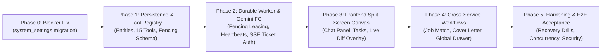

# HyperResume — Agentic AI Career Assistant Implementation Roadmap
## Phased, Independently Testable Engineering Plan (Revision 2.0)

**Document Version:** 2.0.0 (Security & Consistency Revision)  
**Status:** IMPLEMENTATION-READY ROADMAP  
**Methodology:** Incremental Delivery with Zero Breaking Changes to Existing Features  
**Starting Baseline:** 320 Tests (168 Backend + 152 Frontend) Currently 100% Passing  

---

## 1. Phased Delivery Overview



---

## Phase 0: Production Migration Blocker Resolution

### Goal
Restore the missing migration file for `system_settings` so that fresh database setups, CI/CD pipelines, and local development environments do not crash on startup in `AdminService.onModuleInit`.

- **Files to Create:**
  - `backend/src/database/migrations/1728864000008-CreateSystemSettingsTable.ts`
- **Existing Services Reused:**
  - `AdminService` (`backend/src/admin/admin.service.ts`)
  - `SystemSetting` entity (`backend/src/admin/entities/system-setting.entity.ts`)
- **Database Changes:**
  - None on existing database (table already exists). Migration uses `CREATE TABLE IF NOT EXISTS system_settings ("key" VARCHAR(100) PRIMARY KEY, "value" TEXT NOT NULL, "updated_at" TIMESTAMPTZ NOT NULL DEFAULT now());`.
- **Verification Command:**
  ```bash
  bun --cwd backend migration:show
  ```
- **Definition of Done:**
  - `migration:show` displays all 9 migrations marked `[X]`.
  - Running on a clean PostgreSQL instance executes migrations 1 through 9 cleanly and boots NestJS without error.

---

## Phase 1: Agent Persistence & Type-Safe Tool Registry

### Goal
Implement database schema for agent state (including lease fencing tokens and stream tickets) and construct the strongly typed tool registry wrapping existing domain services.

- **Files to Create:**
  - `backend/src/agent/agent.module.ts`
  - `backend/src/agent/entities/agent-conversation.entity.ts`
  - `backend/src/agent/entities/agent-message.entity.ts`
  - `backend/src/agent/entities/agent-task.entity.ts` (with `fence_token`, `heartbeat_at`, `lease_token`)
  - `backend/src/agent/entities/agent-tool-execution.entity.ts` (with `proposal_hash`, `expected_resume_version`, `is_consumed`, `expires_at`)
  - `backend/src/agent/entities/agent-task-event.entity.ts` (with monotonic `sequence_number`)
  - `backend/src/agent/entities/agent-stream-ticket.entity.ts` (for EventSource authentication)
  - `backend/src/database/migrations/1728864000009-CreateAgentEntities.ts`
  - `backend/src/agent/tools/tool.interface.ts`
  - `backend/src/agent/tools/tool-registry.service.ts`
  - `backend/src/agent/tools/definitions/read-resume.tool.ts`
  - `backend/src/agent/tools/definitions/read-resume-versions.tool.ts`
  - `backend/src/agent/tools/definitions/search-jobs.tool.ts`
  - `backend/src/agent/tools/definitions/read-career-profile.tool.ts`
  - `backend/src/agent/tools/definitions/run-ats-audit.tool.ts`
  - `backend/src/agent/tools/definitions/match-job.tool.ts`
  - `backend/src/agent/tools/definitions/generate-bullets.tool.ts`
  - `backend/src/agent/tools/definitions/propose-edits.tool.ts`
  - `backend/src/agent/tools/definitions/generate-cover-letter.tool.ts`
  - `backend/src/agent/tools/definitions/start-interview.tool.ts`
  - `backend/src/agent/tools/definitions/save-job.tool.ts`
  - `backend/src/agent/tools/definitions/create-resume.tool.ts`
  - `backend/src/agent/tools/definitions/apply-edits.tool.ts`
  - `backend/src/agent/tools/definitions/restore-version.tool.ts`
  - `backend/src/agent/tools/definitions/update-career-profile.tool.ts`
- **Files to Modify:**
  - `backend/src/database/entities.ts` (Register new entities in `ALL_ENTITIES`)
  - `backend/src/app.module.ts` (Import `AgentModule`)
- **Existing Services Reused:**
  - `ResumesService`, `ats-audit-engine.ts`, `JobMatchingService`, `JobDiscoveryService`, `CoverLettersService`, `InterviewsService`, `CreditsService`, `FactualIntegrityValidator`.
- **Database Schema Additions:**
  - Tables: `agent_conversations`, `agent_messages`, `agent_tasks`, `agent_tool_executions`, `agent_task_events`, `agent_stream_tickets`.
  - Indexes: `idx_agent_conversations_user`, `idx_agent_tasks_status_heartbeat`, `idx_agent_task_events_seq`, `idx_agent_stream_tickets_hash`.
- **Unit & Integration Tests:**
  - `backend/src/agent/tools/tool-registry.service.spec.ts` (Registry population & schema generation)
  - `backend/src/agent/tools/definitions/*.spec.ts` (Input validation & ownership check for all 15 tools)
- **Security Check:**
  - Verify that tools discard LLM-generated `userId` and strictly enforce `context.userId`.
- **Definition of Done:**
  - All 15 tools registered, tested, and passing unit tests.
  - Migration runs cleanly up and down.
  - Test suite passes 100%.

---

## Phase 2: Durable Worker, Gemini Function Calling & SSE Streaming

### Goal
Build the background task worker with lease fencing tokens, heartbeat recovery, credit reservation lifecycle, Gemini Native Function Calling, and ticket-authenticated SSE streaming with replay deduplication.

- **Files to Create:**
  - `backend/src/agent/agent.controller.ts`
  - `backend/src/agent/agent.service.ts`
  - `backend/src/agent/agent-planner.service.ts`
  - `backend/src/agent/agent-executor.service.ts`
  - `backend/src/agent/durable-task-worker.ts`
  - `backend/src/agent/guards/sse-ticket.guard.ts`
  - `backend/src/agent/dto/agent-message.dto.ts`
  - `backend/src/agent/dto/approve-tool.dto.ts`
- **API Contracts:**
  - `POST /api/v1/agent/conversations` (Create/retrieve conversation)
  - `POST /api/v1/agent/conversations/:id/messages` (Submit user instruction, returns `202 Accepted { taskId }`)
  - `POST /api/v1/agent/conversations/:id/stream-ticket` (Issues single-use 30s ticket for EventSource auth)
  - `GET /api/v1/agent/conversations/:id/stream?ticket=...&lastEventId=...` (SSE event stream with replay deduplication)
  - `POST /api/v1/agent/tasks/:taskId/approve` (Approve/reject staged tool proposal with `proposalHash`)
  - `POST /api/v1/agent/tasks/:taskId/cancel` (Cancel active task)
- **Files to Modify:**
  - `backend/src/ai/providers/gemini-ai.provider.ts` (Add `callGeminiWithFunctions` method accepting tools declaration)
  - `backend/src/credits/credits.service.ts` (Add `reserveCredits`, `commitReservation`, `releaseReservation`)
- **Existing Services Reused:**
  - `CreditsService` (Atomic credit reservation & commit lifecycle)
  - `PromptSanitizer.wrapUntrusted` (Guarding user input in XML tags)
- **Unit & Integration Tests:**
  - `backend/src/agent/durable-task-worker.spec.ts` (Fencing token lease renewal, crash recovery, AWAITING_APPROVAL exclusion)
  - `backend/src/agent/agent-executor.service.spec.ts` (Cryptographic approval verification, proposal hash mismatch, version collision)
  - `backend/src/agent/credits-reservation.spec.ts` (Two-phase reservation, commit, release on AI failure, spending ceiling)
  - `backend/src/agent/sse-stream.spec.ts` (Ticket auth single-use, event replay deduplication)
- **Definition of Done:**
  - A user message triggers an autonomous task, publishes SSE events in real time, pauses at `AWAITING_APPROVAL`, and commits only upon valid cryptographic approval.
  - Stale worker recovery leases cleanly; zombie writes are rejected by fencing tokens.

---

## Phase 3: Frontend Split-Screen Canvas Experience

### Goal
Integrate the conversational co-pilot directly into the resume workspace with a collapsible split-screen layout, user-facing progress indicators, task checklist, and live green/red canvas diffs.

- **Files to Create:**
  - `frontend/components/resumes/AgentChatPanel.tsx`
  - `frontend/components/resumes/AgentTaskProgress.tsx`
  - `frontend/components/resumes/AgentDiffCard.tsx`
  - `frontend/components/resumes/AgentApprovalModal.tsx`
  - `frontend/lib/agent-client.ts` (Ticket-authenticated SSE manager with auto-reconnect)
  - `frontend/lib/agent-client.test.ts`
- **Files to Modify:**
  - `frontend/app/app/resumes/[resumeId]/page.tsx` (Refactor into 40% Agent / 60% Canvas split layout with collapse toggle)
  - `frontend/components/resumes/templates/CanvasEditContext.tsx` (Add visual diff highlight state)
  - `frontend/components/resumes/templates/EditableField.tsx` (Render diff overlay when bullet is modified)
- **Frontend Components & UX:**
  - Left pane: Message stream, plan step progress bar, user-facing status, approval cards with `[Approve & Apply]` / `[Reject]` buttons, metric verification checkboxes.
  - Right pane: Live ATS canvas with smooth-scroll focus and animated green/red diff highlights.
  - Responsive: Drawer toggle on mobile/tablet; persistent split on desktop.
- **Tests:**
  - `frontend/lib/agent-client.test.ts` (SSE ticket exchange, event dispatching, reconnect logic)
  - `frontend/components/resumes/AgentChatPanel.test.tsx` (Rendering streaming messages, approval triggers)
- **Definition of Done:**
  - User can prompt the agent to tailor a bullet, watch the real-time plan execute, see the diff highlighted on the live canvas, verify metric checkboxes, approve it, and see the canvas update instantly.

---

## Phase 4: Cross-Service Workflows & Global Assistant Drawer

### Goal
Connect the agent to the full HyperResume product suite: Job Discovery, Job Matching, Cover Letter Studio, and AI Mock Interviews, and introduce a global assistant drawer.

- **Files to Create:**
  - `frontend/components/layout/GlobalAgentDrawer.tsx`
  - `frontend/components/layout/GlobalAgentButton.tsx`
- **Files to Modify:**
  - `frontend/app/app/layout.tsx` (Mount `GlobalAgentDrawer`)
  - `frontend/app/app/job-search/page.tsx` (Add "Ask Agent to Match" action buttons)
  - `frontend/app/app/cover-letters/page.tsx` (Add Agent prompt bar)
  - `frontend/app/app/interview/page.tsx` (Add Agent interview prep launcher)
- **Workflows Enabled:**
  - "Find jobs -> Tailor resume -> Draft cover letter -> Save to tracker"
  - "Analyze job posting -> Launch personalized mock interview"
- **Tests:**
  - Multi-service workflow integration tests.
  - Global drawer context synchronization tests.
- **Definition of Done:**
  - User can ask the agent on `/app/job-search` to find jobs and tailor their resume in one coherent multi-step journey.

---

## Phase 5: Hardening, Security Auditing & E2E Acceptance

### Goal
Execute end-to-end acceptance journeys, stress test concurrency, verify failure recovery, and complete production launch sign-off.

- **Tests to Execute:**
  - All 5 End-to-End Acceptance Scenarios (`test/agent-scenarios.e2e-spec.ts`).
  - Concurrency testing: 50 concurrent tasks leasing against PostgreSQL row locks.
  - Failure drills: Simulating Gemini 429 rate limits, server SIGTERM restarts, and credit exhaustion.
  - Security audit: Automated penetration probes for cross-tenant data leakage, proposal tampering, and prompt injection.
- **Regression Verification:**
  - Full backend suite (168 + new agent tests = ~260+ tests passing).
  - Full frontend suite (152 + new agent tests = ~185+ tests passing).
  - Zero TypeScript errors (`tsc --noEmit`).
  - Zero Oxlint errors.
- **Definition of Done:**
  - 100% test pass rate across all suites.
  - Security sign-off: zero cross-tenant vulnerabilities.
  - Final Production Readiness Report signed off.

---

*End of Implementation Roadmap Revision 2.0.*
