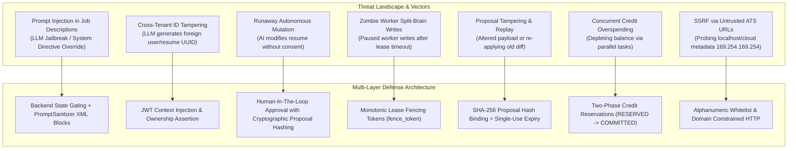

# HyperResume — Agentic AI Career Assistant Security Architecture & Threat Model
## Zero-Trust Agent Governance, Tenant Isolation & Prompt Injection Defense (Revision 2.0)

**Document Version:** 2.0.0 (Security & Consistency Revision)  
**Status:** IMPLEMENTATION-READY SECURITY MODEL  
**Auditor Roles:** Security Architect, Principal AI Systems Engineer  
**Compliance Target:** SOC 2 Type II / GDPR / OWASP Top 10 for LLM Applications (2025/2026)  

---

## 1. Threat Landscape & Multi-Layer Defense Matrix



---

## 2. Deep-Dive Security Defenses

### Layer 1: Prompt Injection Defense — Why Regex/XML Is Not Enough
**CRITICAL SECURITY PRINCIPLE:** Text sanitization and XML delimiters are merely the outermost defense layer. They can be bypassed by sophisticated adversarial prompts. Complete security requires **backend-enforced execution gating**:

1. **Outer Defense (Text Sanitization & XML Delimiters):**
   - Untrusted job postings and candidate answers pass through `PromptSanitizer`.
   - Strip boundary escape markers (`</job_description>`, `<system>`).
   - Wrap in `<untrusted_job_description>` XML delimiters.
2. **Inner Defense (Backend State & Tool Whitelisting):**
   - At each step in the task lifecycle, the backend restricts which tools the agent is permitted to invoke.
   - During `PLANNING`, only read and analysis tools (`read_resume`, `match_job_description`, `propose_resume_edits`) are available in the Gemini function declaration payload.
   - **`apply_approved_edits` is NEVER exposed to Gemini as a callable function declaration.** The model CANNOT execute it regardless of what prompt injection instructions it receives. It is callable ONLY by the backend worker upon receiving a valid, cryptographically signed HTTP approval request from the authenticated human user.
3. **Context Disclosure Prevention:**
   - System prompts enforce strict negative constraints forbidding disclosure of internal prompt instructions, system configuration, or database schemas.
   - All assistant outputs pass through an egress filter stripping detected API keys, internal paths, or database table names.

---

### Layer 2: Strict Tenant Isolation & Resource Ownership
1. **Context-Derived Identity Only:**
   - Under NO circumstances may an LLM argument specify or override `userId`.
   - The tool executor derives `context.userId` exclusively from the verified JWT payload (`@CurrentUser()`). Any `userId` field passed in tool arguments by an LLM is stripped and ignored.
2. **Pre-Execution Ownership Assertion:**
   - Before any tool queries or mutates an entity (`resumeId`, `jobDescriptionId`, `applicationId`), it executes an ownership check:
     ```typescript
     const resume = await this.resumeRepository.findOne({
       where: { id: resumeId, userId: context.userId },
     });
     if (!resume) {
       throw new NotFoundException('Resource not found or access denied');
     }
     ```
   - If an attacker tricks the model into targeting another tenant's UUID, the query yields 0 rows and the task immediately aborts.

---

### Layer 3: Cryptographic Approval Security & Proposal Binding
To prevent proposal tampering, race conditions, or unauthorized modifications, all `STATE_MUTATING` actions require cryptographic approval binding:

1. **Proposal Hash Computation:**
   When `propose_resume_edits` creates a staged proposal:
   $$\text{proposalHash} = \text{SHA-256}(\text{canonicalJson}(\text{proposedDiffPayload}))$$
2. **Database Staging:**
   Stored in `agent_tool_executions`:
   - `proposal_hash` (hex string)
   - `user_id` (context-derived)
   - `task_id` (active task)
   - `resume_id` (target resume)
   - `expected_resume_version` (live version number at proposal creation)
   - `expires_at` (`NOW() + INTERVAL '15 minutes'`)
   - `is_consumed` (`false`)
3. **Approval Verification Pipeline (`POST /agent/tasks/:id/approve`):**
   - Authenticated caller must equal `execution.user_id`.
   - Verify `execution.status == 'PENDING_APPROVAL'` and `is_consumed == false`.
   - Verify `NOW() < execution.expires_at`.
   - Verify `client.proposalHash === execution.proposal_hash`.
   - **Optimistic Concurrency Check:** Query target resume with row lock. Verify `resume.version === execution.expected_resume_version`. If a user manually edited the resume in the canvas during the 15-minute review window, throw `409 ConflictException` and require re-generating the proposal.
   - **Single-Use Burn:** Mark `is_consumed = true` and `status = 'APPROVED'`.
   - **Payload Integrity:** The worker applies ONLY the exact payload stored in `execution.output_payload` on the server. Client-submitted diffs are never applied directly.

---

### Layer 4: Lease Fencing Tokens (Zombie Worker Defense)
In a distributed environment, a worker executing a task might experience a network freeze or GC pause. If a secondary worker assumes the task has timed out and leases it, both workers could attempt to commit mutations.

- Every task maintains a monotonic 64-bit integer `fence_token`.
- When leasing or re-leasing a task:
  ```sql
  UPDATE agent_tasks
  SET fence_token = fence_token + 1,
      lease_token = :workerId,
      heartbeat_at = NOW()
  WHERE id = :taskId ...
  ```
- Every state mutation includes `WHERE id = :taskId AND fence_token = :currentFenceToken`.
- If an old worker awakens and attempts to commit with a stale `fence_token`, the database rejects the update (0 rows affected), and the worker aborts immediately.

---

### Layer 5: Atomic Two-Phase Credit Reservation
To prevent concurrent tasks from overspending a user's credit balance:

1. **Phase 1: Reserve:**
   - Before invoking billable AI inference, `CreditsService.reserveCredits` calculates available balance:
     $$\text{Available} = \sum \text{Committed Credits} - \sum \text{Active Reservations}$$
   - If user lacks Pro Pass and $\text{Available} < \text{Cost}$, throws `ForbiddenException`.
   - Creates a ledger row with `status = 'RESERVED'`, `expires_at = NOW() + INTERVAL '10 minutes'`, and unique idempotency key `reserve_${taskId}_step_${stepIndex}`.
2. **Phase 2: Commit:**
   - Upon successful generation and validation, updates status to `COMMITTED`.
3. **Phase 3: Release / Refund:**
   - If AI call times out, fails, or is rejected, updates status to `RELEASED`, immediately restoring available balance.
4. **Configurable Ceiling:**
   - `MAX_TASK_CREDIT_SPEND = 6` credits cumulative limit per task.

---

### Layer 6: SSRF Prevention & Network Isolation
HyperResume aggregates job listings from external platforms. To prevent Server-Side Request Forgery against cloud metadata (`169.254.169.254`) or localhost services:

1. **Alphanumeric Slug Whitelisting:**
   `JobDiscoveryService` strictly sanitizes ATS board tokens via regex `/^[a-z0-9][a-z0-9_-]{0,62}$/`. Path traversals (`../`) or URL schemes (`http://`) are rejected with `BadRequestException`.
2. **Hardcoded HTTPS Endpoints:**
   Requests are dispatched exclusively to static, whitelisted API hosts:
   - `api.greenhouse.io`
   - `api.ashbyhq.com`
   - `api.lever.co`
   - `remotive.com`
   - `www.arbeitnow.com`
3. **Zero Arbitrary HTTP Tools:**
   The agent does NOT possess any generic `fetch_url` tool.

---

### Layer 7: Career Vault Consent & Factual Provenance
1. **Explicit Opt-In:** `ai_memory_consent` is `false` by default. Long-term memory is active only if explicitly opted-in by the candidate.
2. **Detected vs. Verified Skills:**
   - `detected_skills`: Extracted from documents by AI.
   - `verified_skills`: Confirmed by user.
   - **Invariant:** The AI cannot independently promote skills to verified status.
3. **Evidence Provenance:** Every proposed bullet rewrite must cite source bullet evidence and flag added metrics for user confirmation before applying.
4. **GDPR Cascade Purge:** `DELETE /api/v1/profiles/career-vault` purges all stored preferences immediately. Account deletion cascades across all conversation and task history.

---

*End of Security Architecture Revision 2.0.*
