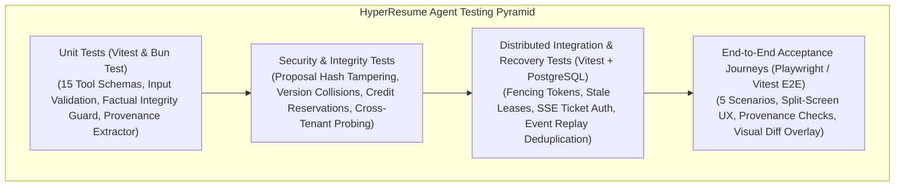

# HyperResume — Agentic AI Career Assistant Test Strategy & Acceptance Matrix
## Multi-Layer Verification, Concurrency, Recovery & E2E Acceptance Suite (Revision 2.0)

**Document Version:** 2.0.0 (Security & Consistency Revision)  
**Status:** IMPLEMENTATION-READY TEST BLUEPRINT  
**Target Quality Standard:** 100% Pass Rate Across Unit, Integration, Security, and E2E Suites  
**Existing Test Baseline:** 320 Tests (168 Backend + 152 Frontend) Currently 100% Passing  
**Test Data Policy:** Strictly Synthetic Candidate Fixtures (Zero Real PII in Test Repositories)  

---

## 1. Test Pyramid & Coverage Targets



---

## 2. Dedicated Security & Recovery Test Suites

### 2.1 Suite 1: Durable Worker & Lease Fencing (`durable-worker.spec.ts`)
1. **Fencing Token Rejection:**
   - Worker A leases Task #1 (`fence_token = 1`).
   - Simulate Worker A hang; advance mock time by 65 seconds.
   - Worker B leases Task #1 (`fence_token = 2`).
   - Worker A wakes up and attempts to commit Step 1 with `fence_token = 1`.
   - **Assertion:** Database update affects 0 rows; Worker A logs `STALE_FENCE_TOKEN` and terminates execution cleanly.
2. **Awaiting Approval Stale Exclusion:**
   - Create Task #2 in status `AWAITING_APPROVAL` with `heartbeat_at = NOW() - INTERVAL '2 hours'`.
   - Run worker leasing query.
   - **Assertion:** Task #2 is NOT leased. It remains in `AWAITING_APPROVAL` until the human user acts.
3. **Recovery from Mid-Plan Crash:**
   - Task with 4 steps has completed Steps 1 and 2.
   - Simulate container crash.
   - Secondary worker re-leases task.
   - **Assertion:** Worker inspects `agent_tool_executions`, identifies Steps 1 & 2 are `COMPLETED`, and initiates execution starting directly at Step 3 without re-running Steps 1 or 2.

### 2.2 Suite 2: Approval Security & Proposal Integrity (`approval-security.spec.ts`)
1. **Proposal Hash Verification:**
   - Formulate proposal with diff payload; server generates `proposalHash = SHA256(diff)`.
   - Client sends approval request with modified hash.
   - **Assertion:** Throws `SecurityException('Proposal hash mismatch')`; resume remains unmutated.
2. **Optimistic Version Collision Detection:**
   - Proposal formulated against resume version 4 (`expectedResumeVersion = 4`).
   - Simulate concurrent manual canvas edit incrementing resume to version 5.
   - Client attempts to approve proposal.
   - **Assertion:** Throws `ConflictException('Resume was modified after proposal generation')`; version 5 preserved.
3. **Single-Use & Expiry Enforcement:**
   - Approve proposal successfully (`is_consumed` set to `true`).
   - Submit duplicate approval request.
   - **Assertion:** Throws `ConflictException('Proposal has already been consumed')`.
   - Submit approval after 16 minutes (`expiresAt` exceeded).
   - **Assertion:** Throws `GoneException('Proposal has expired')`.

### 2.3 Suite 3: Atomic Credit Reservations (`credit-reservation.spec.ts`)
1. **Preflight Reservation & Available Balance:**
   - User with 5 credits initiates task requiring 2 credits.
   - Ledger creates `RESERVED` row (-2).
   - Query available balance: returns 3 credits.
   - Initiate second concurrent task requiring 4 credits.
   - **Assertion:** Throws `ForbiddenException('Insufficient available credit balance')`.
2. **Commit Lifecycle:**
   - On tool success, reservation transitions to `COMMITTED`.
   - Verify ledger history shows committed deduction with matching idempotency key.
3. **Release on AI Failure:**
   - Simulate Gemini API throwing HTTP 503 during inference.
   - **Assertion:** Reservation transitions to `RELEASED`; available balance returns to 5 credits immediately.
4. **Task Spending Cap Enforcement:**
   - Execute task with 3 analysis steps (2 credits each). Total spend reaches 6 credits.
   - Attempt 4th billable tool call.
   - **Assertion:** Task pauses with `TASK_SPENDING_LIMIT_EXCEEDED` and requests user confirmation.

### 2.4 Suite 4: SSE Ticket Auth & Event Replay (`sse-stream.spec.ts`)
1. **Ticket Single-Use & Expiry:**
   - Generate stream ticket via `POST /agent/conversations/:id/stream-ticket`.
   - Connect via `GET /stream?ticket=...`.
   - Attempt to connect second EventSource with same ticket.
   - **Assertion:** Second connection receives HTTP 401 Unauthorized (`Ticket already consumed`).
2. **Replay vs. Live Race Deduplication:**
   - Seed conversation with events sequence 1 through 10.
   - Connect client with `Last-Event-ID: 7`.
   - Simultaneously emit live event sequence 11 and 12 during query execution.
   - **Assertion:** Client receives exactly events 8, 9, 10, 11, 12 in strict monotonic order with zero duplicates or drops.

---

## 3. Synthetic Candidate Fixtures (Zero Real PII)

All automated tests utilize strictly synthetic persona data:

```typescript
// backend/test/fixtures/synthetic-candidate.fixture.ts
export const SYNTHETIC_STAFF_CANDIDATE = {
  fullName: 'Alexander Sharma',
  email: 'alexander.sharma.test@example.com',
  phone: '+1-555-0199',
  location: 'San Francisco, CA',
  headline: 'Staff Infrastructure Engineer | Distributed Systems & Kubernetes',
  summary: 'Distributed systems architect with 10+ years designing high-throughput platforms.',
  experience: [
    {
      company: 'Acme Cloud Corp',
      title: 'Staff Engineer',
      startDate: '2021-01',
      endDate: 'Present',
      current: true,
      bullets: [
        'Architected globally distributed Kubernetes clusters across 3 cloud regions.',
        'Managed Kafka streaming pipelines handling event ingestion.',
        'Slashed service p99 latency from 180ms to 42ms via Go microservice optimization.'
      ]
    }
  ],
  skills: [
    { name: 'Go', category: 'Backend' },
    { name: 'Kubernetes', category: 'Infrastructure' },
    { name: 'Kafka', category: 'Data' }
  ]
};
```

---

## 4. End-to-End Acceptance Scenarios

---

### SCENARIO 1: "Analyze my resume and tell me what is wrong."
- **Initial Conditions:**
  - Synthetic candidate `Alexander Sharma` with 1 active resume (`version: 3`, score: 76/100).
  - Balance: 5 credits.
- **Instruction:** *"Analyze my resume, run an ATS audit, and give me a clear breakdown of what's hurting my score."*
- **Execution Sequence:**
  1. `AgentPlanner` identifies intent -> Plan: `read_resume` -> `run_ats_audit`.
  2. `read_resume` retrieves resume content [READ_ONLY, 0 credits].
  3. `run_ats_audit` executes `ats-audit-engine.ts` [AI_ANALYSIS, 0 credits].
  4. Scorer calculates: Overall 76/100, Quantified Impact 60/100 (detects 4 bullets missing metrics), Action Verbs 70/100 (flags passive openers).
  5. Agent synthesizes concise user-facing recommendations without internal prompt monologue.
- **Database State Changes:**
  - `agent_tasks`: Status `COMPLETED`.
  - `resumes`: ZERO modifications.
  - `credit_ledger`: ZERO deductions.
- **Success Criteria:** User receives 5-dimension score breakdown with bullet citations in $< 3.5$ seconds.

---

### SCENARIO 2: "Find remote Senior React Developer jobs matching my profile."
- **Initial Conditions:**
  - Candidate profile containing React, TypeScript, Next.js.
  - Balance: 5 credits.
- **Instruction:** *"Find remote Senior React Developer openings matching my background and tell me which ones I'm most qualified for."*
- **Execution Sequence:**
  1. Plan: `read_career_profile` -> `search_discovered_jobs`.
  2. `read_career_profile` retrieves verified skills [READ_ONLY, 0 credits].
  3. `search_discovered_jobs` queries Ashby, Greenhouse, Lever [READ_ONLY, 0 credits].
  4. Aggregator scores fit using `computeResumeJobFit`.
  5. Agent formats top 3 job opportunities with match percentages and verified application URLs.
- **Database State Changes:**
  - `agent_tasks`: Status `COMPLETED`.
  - `credit_ledger`: ZERO deductions.
- **Success Criteria:** 3 verified live job postings presented; zero hallucinated jobs; all URLs point to whitelisted ATS domains.

---

### SCENARIO 3: "Tailor my resume for this job."
- **Initial Conditions:**
  - Active resume open in split-screen canvas (`version: 3`, score: 74/100).
  - Target Job Description: Stripe Staff Infrastructure Engineer posting.
  - Balance: 5 credits.
- **Instruction:** *"Tailor my resume for this Stripe Staff Infrastructure position. Emphasize my distributed systems and Kafka achievements."*
- **Execution Sequence:**
  1. Plan: `read_resume` -> `match_job_description` -> `propose_resume_edits` -> `apply_approved_edits` (HITL).
  2. `read_resume` retrieves resume content [READ_ONLY, 0 credits].
  3. `match_job_description` reserves 1 credit, runs requirement matching, commits 1 credit [AI_ANALYSIS, 1 credit].
  4. `propose_resume_edits` reserves 2 credits, calls Gemini, validates metrics via `FactualIntegrityValidator`, computes `proposalHash`, stages proposal, and commits 2 credits [AI_ANALYSIS, 2 credits].
  5. Task transitions to `AWAITING_APPROVAL`. Worker stops leasing.
  6. SSE emits `approval_requested` event containing `proposalHash`, diff payload, and evidence provenance.
  7. Frontend displays visual diff card in chat panel and green/red highlights on canvas. Metric checkboxes displayed.
  8. **Human Action:** User verifies metric checkbox and clicks `[Approve & Apply]`.
  9. Frontend issues `POST /agent/tasks/:id/approve` with `proposalHash`.
  10. Backend verifies hash, verifies resume version is still 3, marks proposal consumed, applies diff, increments version to 4, creates `ResumeVersion` snapshot, and runs ATS audit (score: 88/100).
  11. Worker marks task `COMPLETED` and emits `resume_updated`.
- **Database State Changes:**
  - `resumes`: Content updated, `version = 4`.
  - `resume_versions`: New snapshot created (version 4).
  - `credit_ledger`: -3 credits total (1 match + 2 tailor).
- **Success Criteria:** Resume content changes ONLY after explicit human click; canvas updates live; version history reflects snapshot.

---

### SCENARIO 4: "Find jobs, tailor my resume and prepare a cover letter."
- **Initial Conditions:**
  - Active resume open in workspace. Balance: 10 credits.
- **Instruction:** *"Find me remote infrastructure jobs, pick the top Stripe position, tailor my resume for it, and draft a cover letter."*
- **Execution Sequence:**
  1. `search_discovered_jobs` -> returns Stripe Staff Infra [READ_ONLY, 0 credits].
  2. `save_job_to_tracker` -> creates `job_applications` row as `saved` [SAFE_MUTATING, 0 credits, auto].
  3. `propose_resume_edits` -> generates tailored diff with hash [AI_ANALYSIS, 2 credits].
  4. Task pauses at `AWAITING_APPROVAL`. User reviews and clicks `[Approve & Apply]`.
  5. `apply_approved_edits` commits changes to resume [STATE_MUTATING, 0 credits].
  6. `generate_cover_letter` -> drafts tailored cover letter in `cover_letters` table [AI_ANALYSIS, 2 credits].
- **Database State Changes:**
  - 1 `job_applications` row.
  - 1 `resume_versions` row.
  - 1 `cover_letters` draft row.
  - `credit_ledger`: -4 credits total.
- **Success Criteria:** Multi-service orchestration completes cleanly; zero unapproved resume mutations.

---

### SCENARIO 5: "Prepare me for an interview for this role."
- **Initial Conditions:**
  - Active resume and target JD linked in conversation. Balance: 5 credits.
- **Instruction:** *"I have a technical screening coming up for this role. Set up a mock interview and ask me the first question."*
- **Execution Sequence:**
  1. Plan: `read_resume` -> `start_interview_session`.
  2. `read_resume` retrieves resume context [READ_ONLY, 0 credits].
  3. `start_interview_session` reserves 2 credits, calls `InterviewsService.startSession`, commits 2 credits [AI_ANALYSIS, 2 credits].
  4. Generates 5 tailored technical/behavioral questions grounded directly in candidate's resume claims.
  5. Emits `interview_started` with first question into chat panel.
- **Database State Changes:**
  - 1 `interview_sessions` row.
  - 5 `interview_questions` rows.
  - `credit_ledger`: -2 credits.
- **Success Criteria:** Questions directly reference candidate claims; interview practice active in workspace.

---

*End of Test Strategy Revision 2.0.*
