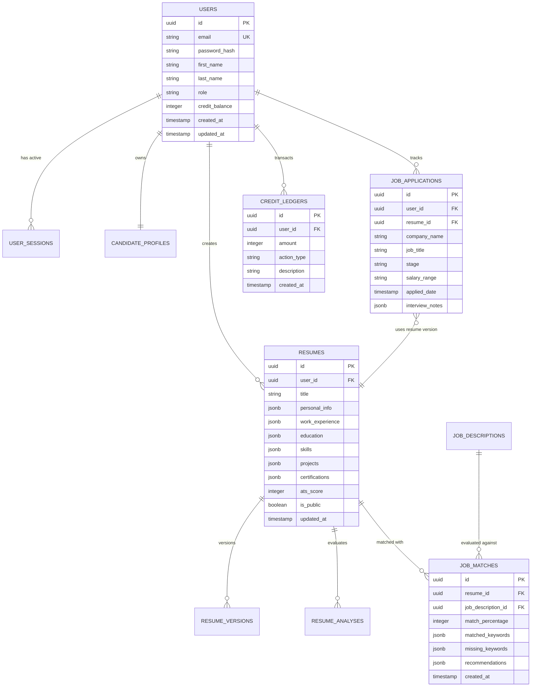

# System Architecture — HyperResume

**Document Version**: 2.0.0  
**Last Updated**: October 27, 2026  
**System Classification**: Enterprise AI Resume Builder & ATS Job Matching Platform  

---

## 1. High-Level System Architecture

HyperResume is architected as a high-performance, decoupled client-server platform designed for sub-second page loads, real-time ATS scoring, and enterprise-grade data security.

```
                              ┌──────────────────────────────────────────────┐
                              │             Client Browser                   │
                              │  (Next.js 15 + React 19 + Tailwind CSS)     │
                              └───────┬──────────────────────────────┬───────┘
                                      │                              │
                          HTTPS / HTML / Static Bundles        REST / JSON / Auth Bearer
                                      │                              │
                                      ▼                              ▼
                        ┌──────────────────────────────┐ ┌──────────────────────────────┐
                        │    Nginx Reverse Proxy       │ │    Nginx Reverse Proxy       │
                        │ (resume.fourth-coffee.shop)  │ │(resume-api.fourth-coffee.shop│
                        └─────────────┬────────────────┘ └─────────────┬────────────────┘
                                      │ Upstream :3082                 │ Upstream :3002
                                      ▼                                ▼
                        ┌──────────────────────────────┐ ┌──────────────────────────────┐
                        │    Next.js 15 Standalone     │ │    NestJS 10.x REST API      │
                        │    PM2 Process: ID 14        │ │    PM2 Process: ID 13        │
                        │    Runtime: Node.js 20+      │ │    TypeORM + JWT + Passport  │
                        └──────────────────────────────┘ └─────────────┬────────────────┘
                                                                       │
                                                       ┌───────────────┴───────────────┐
                                                       │                               │
                                                       ▼                               ▼
                                        ┌──────────────────────────────┐ ┌──────────────────────────────┐
                                        │  PostgreSQL 16 Database      │ │  OpenAI / AI Engine Provider │
                                        │  Tables: Users, Resumes,     │ │  (GPT-4o / Claude 3.5 Sonnet)│
                                        │  Applications, Ledger        │ │  STAR Optimization & Scoring │
                                        └──────────────────────────────┘ └──────────────────────────────┘
```

---

## 2. Technology Stack Breakdown

### 2.1 Frontend Client
* **Framework**: Next.js 15.1.0 (App Router architecture with React Server Components + Client Islands)
* **View Engine**: React 19.0.0 with hooks (`useState`, `useEffect`, `useMemo`, `useCallback`, custom context providers)
* **Styling**: Tailwind CSS 3.4.17 with custom HSL/HEX design tokens, dark/light theme switching, and Vanilla CSS enhancements
* **Icons**: Lucide React (`lucide-react`)
* **State Management**:
  * `AuthContext` (`frontend/lib/auth-context.tsx`): Persistent session storage, user profile, token verification, and credits tracking.
  * `ThemeContext` (`frontend/lib/theme-context.tsx`): HTML class toggling (`dark` / `light`), system theme auto-detection, and local preference storage.
* **API Client**: `frontend/lib/api-client.ts`: Custom typed fetch wrapper with automatic JWT header attachment, bearer token renewal, and graceful error normalization.

### 2.2 Backend Application
* **Framework**: NestJS 10.x (TypeScript-first modular architecture)
* **HTTP Layer**: Fastify / Express adapter with global CORS, Helmet security headers, and ValidationPipe
* **ORM**: TypeORM with PostgreSQL 16 driver (`pg`)
* **Authentication**: Passport.js with JWT Strategy (`@nestjs/jwt`), bcrypt password hashing (10 rounds), and session tracking
* **AI Engine & Analysis**:
  * Custom STAR / XYZ bullet structure evaluation algorithms
  * Keyword extraction and density analyzer for Job Descriptions vs. Candidate Content
  * LLM prompt pipelines for evidence-grounded resume tailoring and bullet optimization

### 2.3 Database Tier
* **RDBMS**: PostgreSQL 16
* **Data Integrity**: Foreign key constraints with `ON DELETE CASCADE`, indexed search fields, timestamp audit triggers (`created_at`, `updated_at`).
* **Connection Pooling**: Managed via TypeORM connection pooling (10 connections max per worker).

---

## 3. Frontend Architecture & Component Hierarchy

### 3.1 Public Surface (`/` and `/examples`)

```
app/
├── layout.tsx                     # Root HTML skeleton, Inter fonts, ThemeProvider, AuthProvider
├── page.tsx                       # Landing Page Master Assembly
│   ├── InteractiveHeroStudio.tsx  # Dynamic ATS scanner simulation & instant editor preview
│   ├── CompanyLogoCloud.tsx       # Tier-1 Tech, Finance, and Enterprise logos
│   ├── AtsCompatibilityCloud.tsx  # Workday, Greenhouse, Lever, Taleo, BambooHR logos & badges
│   ├── ReziStyleScoreFeatureSection.tsx # Rezi-inspired 100-point ATS score gauge breakdown
│   ├── ProductWorkflowPreview.tsx # 3-step interactive pipeline (Import -> Optimize -> Match)
│   ├── InteractiveTemplateShowcase.tsx # Live resume preview carousel with downloadable assets
│   ├── SystemStatusBadge.tsx      # Real-time API latency & uptime monitor
│   └── Footer.tsx                 # Comprehensive sitemap, legal links, status, and theme toggle
│
└── examples/page.tsx              # Sample Resume Library (/examples)
    └── SampleLibraryView.tsx      # Search bar, 9 category filter pills, sort controls
        ├── SampleResumeCard.tsx   # Individual resume card with company badge, score pill, stats
        └── SampleResumeModal.tsx  # Fullscreen A4 preview, raw text copy, and template clone action
```

### 3.2 Authenticated Workspace (`/app/*`)

```
app/app/
├── layout.tsx                     # Dashboard shell, Top navigation bar, Credit balance badge, User dropdown
├── page.tsx                       # Dashboard Overview (Recent resumes, match score tracker, stats)
│
├── resumes/
│   ├── page.tsx                   # Resume List: Create new, duplicate, import JSON, or delete
│   └── [resumeId]/page.tsx        # Deep Resume Studio & Editor (STAR improver, PDF preview, parser audit)
│
├── match/
│   └── page.tsx                   # Job Match Engine: Paste job description, compare keyword density, optimize
│
├── applications/
│   ├── page.tsx                   # Job Application Tracker Master
│   ├── ApplicationKanbanView.tsx  # 6-column drag/drop Kanban (Wishlist -> Applied -> Screening -> Offer)
│   ├── ApplicationTableView.tsx   # Sortable tabular view with company, salary, interview dates
│   └── ApplicationDeepWorkspace.tsx# Deep application drawer: notes, interview prep questions, tailored resume
│
└── settings/
    └── page.tsx                   # User profile, API keys, password reset, credit billing history
```

---

## 4. Backend Architecture & Domain Modules

The NestJS backend is partitioned into domain-specific feature modules:

| Module | Core Responsibility | Key Entities |
| :--- | :--- | :--- |
| `AuthModule` | User registration, login, JWT issuance, password reset, session revoke | `UserSession`, `User` |
| `UsersModule` | User profile retrieval, preference management, credit balance queries | `User` |
| `ProfilesModule` | Candidate career history, education, certifications, and skills profile | `CandidateProfile` |
| `ResumesModule` | Resume CRUD, multi-version snapshots, PDF compilation, ATS audit engine | `Resume`, `ResumeVersion`, `ResumeAnalysis` |
| `JobMatchingModule` | Job description intake, skill gap analysis, ATS score calculation | `JobDescription`, `JobMatch` |
| `ApplicationsModule`| Application pipeline tracking, status transitions, interview logs | `JobApplication` |
| `CreditsModule` | Usage ledger, debit/credit transactions, subscription tiers | `CreditLedger` |
| `AiModule` | LLM prompt formatting, bullet point enhancement, STAR restructuring | N/A (Stateless AI Service) |
| `HealthModule` | Liveness, readiness, and database connection checks (`/health`) | N/A |

---

## 5. Relational Data Model (Entity Relationship)



---

## 6. End-to-End Request & Data Flow

### 6.1 User Authentication Flow
1. User enters credentials or clicks "Auto-fill Demo Account" on `/login`.
2. Frontend sends `POST https://resume-api.fourth-coffee.shop/api/v1/auth/login`.
3. Backend validates password hash via `bcrypt.compare`.
4. Backend issues a signed JWT containing `{ sub: user.id, email: user.email }` with a 7-day expiration.
5. Frontend saves token in `localStorage.setItem('hyperresume_token', token)` and updates `AuthContext`.
6. Subsequent requests automatically inject `Authorization: Bearer <token>`.

### 6.2 ATS Resume Optimization & STAR Flow
1. In `app/app/resumes/[resumeId]/page.tsx`, candidate enters work experience bullets.
2. Candidate clicks **"Optimize with STAR Formula"**.
3. Frontend triggers `POST /api/v1/resumes/:id/optimize-bullet` with the bullet text.
4. AI service analyzes the sentence against the STAR framework:
   - **Situation / Task**: Context and business problem.
   - **Action**: Strong action verb (e.g., *Architected*, *Engineered*, *Spearheaded*).
   - **Result**: Quantifiable business impact (%, $, latency, throughput).
5. AI returns structured improvements and revised text.
6. Real-time Rezi-Style Score Meter updates score from 0 to 100 instantly.

---

## 7. Security & Privacy Architecture

* **Zero Training Data Leaks**: User resume data is never transmitted to public LLM training datasets.
* **Encryption in Transit**: Strict TLS 1.3 encryption enforced by Nginx with Let's Encrypt certificates.
* **CORS Restrictions**: Configured to strictly accept requests originating from `https://resume.fourth-coffee.shop` and local development origins (`localhost:3000`, `localhost:3001`, `localhost:3082`).
* **Rate Limiting**: NestJS `@nestjs/throttler` protects sensitive authentication and AI generation endpoints from abuse.
