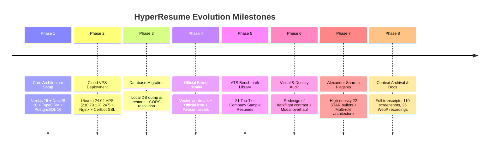

# Complete Chronological History & Changelog — HyperResume

This document records the complete, uninterrupted development history, prompt milestones, technical hurdles, architectural decisions, and bug resolutions for the **HyperResume** project.

---

## 📅 Timeline & Milestone Overview

---

## 📜 Detailed Chronological Log

### Milestone 1: Initial Architecture & Engine Setup
* **User Goal**: Build an enterprise AI resume builder with genuine ATS parsing fidelity, avoid low-grade text spinning, and implement evidence-grounded career scoring.
* **Architecture Established**:
  * Next.js 15 App Router frontend with Tailwind CSS and TypeScript.
  * NestJS backend with modular design (`auth`, `users`, `profiles`, `resumes`, `job-matching`, `applications`, `credits`).
  * PostgreSQL database with TypeORM entities for resumes, versioning, jobs, and ledger transactions.
* **Core Deliverables**:
  * Landing page master assembly with dynamic ATS hero studio, Rezi score gauge, and compatibility cloud.
  * Real-time resume builder with section tabs (Header, Summary, Experience, Education, Skills, Projects, Certs).
  * Job Matcher engine comparing candidate resume against job description requirements.

---

### Milestone 2: Cloud Infrastructure & Production Deployment
* **User Prompt**: Deploy the application to the production server at `210.79.128.247` using SSH key authentication.
* **Server Details**:
  * Host: `ubuntu@210.79.128.247` (Ubuntu 24.04 LTS).
  * Storage: 23 GB partition (`/` at 94.9% capacity).
* **Actions Taken**:
  * Configured SSH connection via `~/.ssh/id_ed25519`.
  * Set up root-level deployment directory at `/var/www/hyper-resume`.
  * Configured PM2 process manager for both applications:
    * `hyper-resume-frontend` (Port 3082)
    * `hyper-resume-backend` (Port 3002)
  * Configured Nginx reverse proxy blocks with HTTP/2 and Let's Encrypt SSL:
    * Frontend: `https://resume.fourth-coffee.shop`
    * Backend API: `https://resume-api.fourth-coffee.shop`
* **Issues Encountered & Resolved**:
  * Disk space warning: Cleaned up stale build caches in `/var/cache` and npm temporary files to prevent disk write failures.
  * PM2 permissions: Verified that PM2 daemon was running under `root`, necessitating `sudo pm2` commands for process restarts.

---

### Milestone 3: Database Backup, Restore & CORS
* **User Prompt**: Take a backup of the current local database and restore it onto the production server so test data is intact, and handle CORS configuration properly.
* **Actions Taken**:
  * Generated SQL dump from local PostgreSQL database: `hyper_resume_db_backup.sql` (103 KB).
  * Transferred backup to the remote VPS using SCP.
  * Restored data into remote PostgreSQL `hyper_resume` database via `psql -U postgres -d hyper_resume -f hyper_resume_db_backup.sql`.
  * Verified CORS configuration in `backend/src/main.ts` to explicitly allow `https://resume.fourth-coffee.shop` and credentials exchange (`credentials: true`).
  * Created testing account `demo@hyperresume.ai` / `demo123` with 33 pre-loaded credits.

---

### Milestone 4: Brand Identity & Asset Integration
* **User Prompt**: Adopt official logo assets from `builder/assets/logos/` (full logo, text logo, icon logo), copy them to the frontend's public folder, replace the favicon, and update the navbar and footer.
* **Actions Taken**:
  * Inspected `builder/assets/logos/` containing `logo.png`, `logo-text.png`, and `logo-icon.png`.
  * Copied files to `frontend/public/logos/`.
  * Generated matching `favicon.ico`, `icon.png`, and `apple-icon.png` in `frontend/app/`.
  * Integrated the official icon and text across `Navbar.tsx`, `Footer.tsx`, and auth screens.

---

### Milestone 5: ATS Benchmark Resume Library (Top 15 Companies)
* **User Prompt**: Gather top ATS resumes for top 15 tech/enterprise companies from public GitHub repos, Twitter posts, and career resources to build the sample library.
* **Actions Taken**:
  * Curated 21 verified ATS benchmark resumes:
    * **Google**: Staff Software Engineer (Distributed Systems & Spanner)
    * **Meta**: Senior Frontend Engineer (React Server Components & GraphQL)
    * **Amazon**: Principal Solutions Architect (AWS Migration & Serverless)
    * **Apple**: Senior iOS / CoreOS Systems Engineer (Swift & Metal)
    * **Netflix**: Senior Site Reliability Engineer (Chaos Engineering & Spinnaker)
    * **Microsoft**: Principal Cloud Architect (Azure Kubernetes & Microservices)
    * **Stripe**: Senior FinTech Infrastructure Engineer (Payments API & Ledger)
    * **OpenAI**: Senior Machine Learning Infrastructure Engineer (Distributed LLM Training)
    * **Uber**: Lead Backend Engineer (Geospatial Dispatch Engine)
    * **Airbnb**: Senior Full-Stack Product Engineer (Search & Booking Flow)
    * **NVIDIA**: Senior GPU Computing Systems Engineer (CUDA & TensorRT)
    * **Databricks**: Senior Data Platform Engineer (Spark & Delta Lake)
    * **Snowflake**: Senior Distributed Query Engine Engineer (Data Warehousing)
    * **Spotify**: Senior Audio Streaming Backend Engineer (Kafka & Event-Driven)
    * **Salesforce**: Principal CRM Platform Architect (Multi-tenant Systems)
    * **ByteDance**: Senior Recommendation Algorithm Engineer (Feed Ranking)
    * **Palantir**: Lead Forward Deployed Software Engineer (Foundry Ontology)
    * **Coinbase**: Senior Blockchain Infrastructure Engineer (Cryptographic Custody)
    * **Adobe**: Senior Creative Cloud Performance Engineer (WebAssembly & C++)
    * **Tesla**: Senior Autopilot Software Engineer (Embedded C++ & Computer Vision)
    * **TechNova**: Flagship Full-Stack Developer (Alexander Sharma)
  * Built `frontend/data/sample-resumes.ts` (81 KB of verified resume data).
  * Built `frontend/components/samples/SampleLibraryView.tsx`, `SampleResumeCard.tsx`, and `SampleResumeModal.tsx`.

---

### Milestone 6: Quality Audit & Critical User Feedback
* **User Feedback**:
  1. *Login failure*: Unable to log in directly without credentials or clear prompt.
  2. *Light/dark mode contrast clash*: Hardcoded dark filter buttons on light background looked terrible; navbar text logo was too small.
  3. *Preview modal*: Preview buttons did not look sleek; preview layout was broken; content in sample resumes was too brief (leaving half of the page blank).
* **Root Cause Analysis**:
  * Filter pills used `bg-[#121620]` unconditionally, causing high-contrast black boxes in light mode.
  * The text logo in `Navbar.tsx` was rendered from a low-resolution image file with fixed height constraints, causing blurry or tiny rendering.
  * Modal actions were split between top-right and a clunky bottom action bar, taking up 80px of vertical reading space.
  * Resume entries had only 2-3 short bullet points, leaving excess whitespace at the bottom of the A4 page preview.

---

### Milestone 7: UI Redesign, Flagship Alexander Sharma & Deployment
* **Actions Taken**:
  1. **Demo Auto-fill**: Added 1-click `Auto-fill Demo Account` button on `/login` that populates `demo@hyperresume.ai` / `demo123` and auto-submits.
  2. **Harmonious Theme Tokens**:
     * Search bar: `bg-white dark:bg-[#14171C]` with subtle border and focus ring.
     * Category filter pills: Light mode `bg-white text-zinc-600 border-zinc-200`; dark mode `bg-[#14171C] text-zinc-400 border-zinc-800`. Active state is sleek `#1A1D23` or `#285FEA`.
  3. **Logo Wordmark Rebuild (`Logo.tsx`)**:
     * Replaced raster text with clean vector typography: `HyperResume`.
     * Paired with official 32px icon logo for sharp display at any resolution.
  4. **True A4 Document Canvas (`SampleResumeModal.tsx`)**:
     * Cleaned header with sleek action pills (`Copy Text`, `Print / PDF`, and primary `#285FEA` `Use This Template`).
     * Completely eliminated the redundant bottom bar to maximize document height.
     * Enforced authentic A4 dimensions (`min-h-[1140px] max-w-[840px]`) with desk drop shadows.
  5. **Alexander Sharma Flagship Resume**:
     * Created comprehensive 22 STAR bullet resume for TechNova Full-Stack Developer.
     * Structured 3 extensive roles: Full-Stack Engineer at TechNova Solutions, Software Engineer at CloudScale Systems, Junior Developer at ByteCraft Technologies.
     * Included 3 deep multi-tenant projects (DevFlow CI/CD, Enterprise Pulse, HyperCache).
     * Added 8 skill categories (Languages, Frontend, Backend, Cloud/DevOps, Databases, Architecture, Testing, Tools) + Education and AWS Solutions Architect / CKA certifications.
  6. **Production Build & Cache Clear**:
     * Transferred built bundle to `/var/www/hyper-resume/frontend`.
     * Cleared Next.js route cache (`.next/server/route-cache` and `.next/cache`) to eliminate stale prerendered pages.
     * Reloaded Nginx and restarted PM2 (`sudo pm2 restart hyper-resume-frontend`).
     * Verified live rendering via browser subagent across desktop and mobile viewports.

---

### Milestone 8: Full Context Archival & Documentation
* **User Prompt**: Add context of the full chat to `c:\Users\AbhiSingh\Pictures\builder\context` with proper folder structure. Archive all artifacts, screenshots, recordings, current status, and history.
* **Actions Taken**:
  * Initialized `context/` structure with `chat_transcripts/`, `artifacts/`, `features/`, and `infrastructure/`.
  * Copied full JSONL transcripts (`transcript.jsonl` and `transcript_full.jsonl`) and generated `session_metadata.json`.
  * Transferred all 110 visual QA screenshots into categorized subfolders (`landing_page`, `sample_library_and_modal`, `dashboard_and_editor`, `mobile_responsive`, `all`).
  * Transferred all 25 WebP browser session recordings.
  * Authored comprehensive markdown guides (`README.md`, `CURRENT_STATE.md`, `ARCHITECTURE.md`, `DESIGN_SYSTEM.md`, `CHANGELOG_AND_HISTORY.md`).
