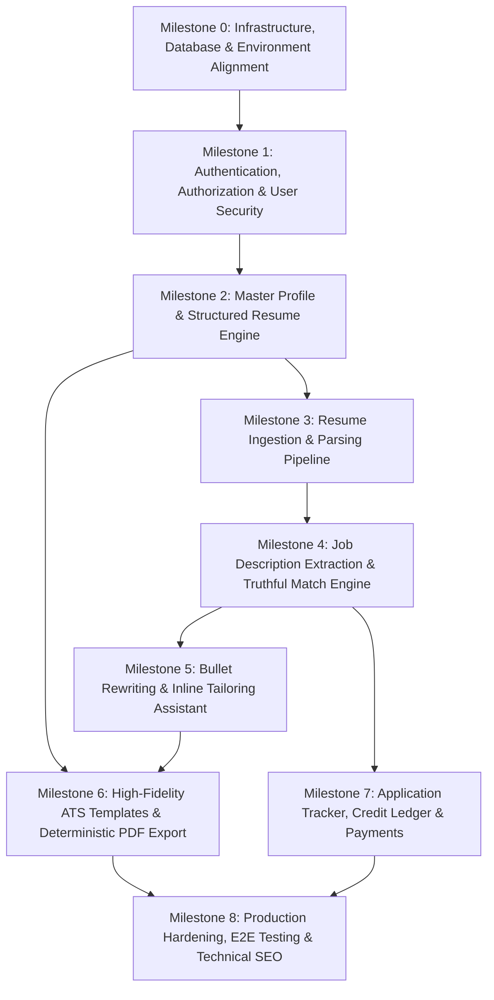

# HyperResume — Master Phased Implementation Plan

**Document Version:** 1.0.0  
**Date:** 2026-10-13  
**Status:** Approved Architectural Blueprint  
**Authors:** Principal Engineering & Architecture Team  

---

## 1. Executive Summary & Repository Assessment

### 1.1 Current Workspace State (Verified via Repository Inspection)
Inspection of `/home/abhi-singh/Workarea/Business/Resume-builder` was performed across filesystem, package configurations, Git status, and running runtimes.

| Layer | Technology & Version | Status & Observations |
|---|---|---|
| **Repository Topology** | Multi-root / Split-Git | Root is **not** a unified Git repo. `frontend/` has its own Git repo (`main`, clean), and `backend/` has its own Git repo (`master`, untracked starter files). |
| **Package Manager** | Bun `1.3.2` | Both `frontend/` and `backend/` contain valid `bun.lock` files. Node.js `v22.22.2` and npm `10.9.7` are also available. |
| **Backend Runtime** | NestJS `12.0.1`, TypeScript `6.0.2` | ESM (`"type": "module"`). Builds cleanly (`nest build`). Unit tests pass with Vitest `4.1.2`. Linting runs with oxlint `1.58.0`. |
| **Frontend Runtime** | Next.js `16.4.0`, React `19.3.0`, TailwindCSS `v4` | Turbopack enabled (`next.config.ts`), TypeScript `5`. Builds cleanly (`next build`) and lints cleanly with ESLint `9`. Currently minimal starter template. |
| **Database** | PostgreSQL on `localhost:5432` | Port 5432 is actively listening and responsive. Target database `hyper_resume_db` is created. |
| **Local Environment Config** | `.env` present in `backend/` | `PORT=3001`, `NODE_ENV=development`, `DATABASE_NAME=hyper_resume_db`. `.env.example` templates created for both backend and frontend. |

### 1.2 Identified Architectural Gaps to Address
1. **Database ORM & Migrations:** Backend currently lacks `@nestjs/typeorm`, `typeorm`, and `pg`. TypeORM must be configured with `synchronize: false` and strict migration workflows.
2. **Configuration & Validation:** Backend lacks `@nestjs/config`, `class-validator`, and `class-transformer` for server-side DTO validation.
3. **Telemetry Worker:** Backend `app.module.ts` initializes `@nestjs/observe` with dummy credentials (`YOUR_APP_KEY`), triggering `ObserveAgentWorker exit code 1` during E2E testing. This must be cleanly disabled or made strictly opt-in.
4. **Port & CORS Alignment:** `backend/src/main.ts` listens on `process.env.PORT ?? 3000`, while the standard port for backend is `3001` (frontend on `3000`). Needs explicit fallback to `3001` and CORS configuration allowing `FRONTEND_URL`.
5. **No Schema / Models:** No database entities, tables, auth guards, or business logic exist yet.

---

## 2. Core Architectural Principles & Invariants

1. **Strict TypeScript & ESM:** All code across frontend and backend written with strict type safety. Zero `any` in business logic.
2. **Server-Side Validation & Untrusted Inputs:** Never trust client assertions (credits, roles, ownership, file contents, job descriptions). Every endpoint validates via class-validator DTOs.
3. **Multi-Tenant Ownership Invariant:** Every user-owned database query MUST verify user ownership (`where: { id, userId }`). A valid UUID is never accepted as proof of authorization.
4. **Synchronize: false & Migration Rigor:** Database schema changes are committed exclusively via reversible TypeORM migration files. Never drop or recreate tables automatically.
5. **Truthful AI Guardrails:** The platform never fabricates or hallucinates candidate skills, metrics, companies, dates, or credentials. Match scores are strictly explainable compatibility indicators.
6. **Deterministic Document Quality:** Resume templates must adhere to strict ATS parsing rules and compile to high-resolution, selectable-text PDFs without visual glitches or cutoffs.

---

## 3. Phased Implementation Roadmap



---

### Milestone 0: Foundational Infrastructure, Database & Environment Alignment
**Objective:** Wire up NestJS with TypeORM, PostgreSQL, ConfigModule, validation pipes, and remove starter friction.

- **Dependencies:** None.
- **Main Files / Modules:**
  - `backend/src/config/configuration.ts`: Typed environment configuration using `@nestjs/config`.
  - `backend/src/database/typeorm.config.ts`: TypeORM DataSource configuration with migrations directory.
  - `backend/src/database/database.module.ts`: Database connection module (`synchronize: false`).
  - `backend/src/main.ts`: Update port fallback to `3001`, enable CORS for `FRONTEND_URL`, install global `ValidationPipe({ transform: true, whitelist: true })`.
  - `backend/src/app.module.ts`: Clean up `@nestjs/observe` dummy credentials.
  - `backend/package.json`: Install `@nestjs/typeorm`, `typeorm`, `pg`, `@nestjs/config`, `class-validator`, `class-transformer`.
- **Acceptance Criteria:**
  - Backend starts cleanly on `PORT=3001` with `bun run start:dev`.
  - TypeORM successfully connects to `hyper_resume_db` on `localhost:5432`.
  - TypeORM CLI runs migration check without error.
  - Unit and e2e test suites run cleanly without worker crash warnings.
- **Test Strategy:**
  - Database connectivity integration test.
  - Health check endpoint `/api/health` returning 200 and database status.

---

### Milestone 1: Authentication, Authorization & User Security
**Objective:** Deliver secure, multi-tenant user authentication with password hashing, JWTs, role management, and ownership guards.

- **Dependencies:** Milestone 0.
- **Main Files / Modules:**
  - `backend/src/users/entities/user.entity.ts`: User table (`id` UUID, `email` unique, `passwordHash`, `fullName`, `role`, timestamps).
  - `backend/src/database/migrations/*-CreateUsersTable.ts`: First TypeORM migration.
  - `backend/src/auth/auth.module.ts`, `auth.controller.ts`, `auth.service.ts`: Registration, login, profile, and logout.
  - `backend/src/auth/dto/register.dto.ts`, `login.dto.ts`, `user-response.dto.ts`: Strict input/output DTOs ensuring `passwordHash` is never leaked.
  - `backend/src/auth/guards/jwt-auth.guard.ts`: JWT bearer guard.
  - `backend/src/auth/decorators/current-user.decorator.ts`: Parameter decorator for authenticated user.
  - `frontend/app/(auth)/login/page.tsx`, `frontend/app/(auth)/register/page.tsx`: Premium SaaS login & signup screens.
  - `frontend/lib/api-client.ts`: Typed API client handling JWT tokens and authorization headers.
  - `frontend/context/auth-context.tsx`: Client-side authentication provider.
- **Acceptance Criteria:**
  - User can register with valid credentials (email format and password complexity enforced).
  - Passwords hashed using bcrypt/argon2; never stored or returned in plaintext.
  - Login returns valid JWT and user profile.
  - Unauthorized requests to protected routes return 401 Unauthorized.
  - Password hashes, provider tokens, or internal secrets are strictly excluded from all API responses.
- **Test Strategy:**
  - Unit tests for password hashing and validation rules.
  - Controller integration tests for `/api/auth/register` and `/api/auth/login`.
  - E2E tests validating token expiration and invalid token rejection.

---

### Milestone 2: Master Profile & Structured Resume Data Engine
**Objective:** Implement the structured resume data model, CRUD APIs with multi-tenant ownership enforcement, and the desktop-optimized 3-column resume editor.

- **Dependencies:** Milestone 1.
- **Main Files / Modules:**
  - `backend/src/resumes/entities/resume.entity.ts`: Resume model (`id`, `userId`, `title`, `isMaster`, `targetRole`, `completenessScore`).
  - `backend/src/resumes/entities/resume-section.entity.ts`: Polymorphic/structured sections:
    - Contact / Personal Info
    - Professional Summary
    - Work Experience (company, title, location, startDate, endDate, isCurrent, bullets array)
    - Education (institution, degree, field, graduationDate, gpa/grade)
    - Projects (title, description, tools/technologies, link, bullets)
    - Skills (category, name, proficiency, verifiedEvidence)
    - Certifications & Awards
  - `backend/src/database/migrations/*-CreateResumesAndSections.ts`.
  - `backend/src/resumes/resumes.controller.ts`, `resumes.service.ts`: Endpoints with strict `{ userId: user.id }` checks.
  - `backend/src/resumes/dto/create-resume.dto.ts`, `update-resume.dto.ts`, `resume-response.dto.ts`.
  - `frontend/app/resumes/page.tsx`: Resume list dashboard with creation modals and empty states.
  - `frontend/app/resumes/[id]/page.tsx`: 3-panel productivity editor:
    - Left: Section tree navigation & structured forms.
    - Center: Real-time live resume preview.
    - Right: AI recommendations & ATS gap assistant.
  - `frontend/components/resume/`: Modular editors (`ExperienceForm`, `EducationForm`, `SkillsForm`, `BulletListEditor`).
- **Acceptance Criteria:**
  - Users can create, view, update, and delete their master resume and tailored versions.
  - Cross-user data isolation: Attempting to access another user's resume UUID returns 404 or 403.
  - Real-time autosave with clear visual indicators ("Saving...", "Saved").
  - Form validation prevents invalid dates, empty titles, or oversized text blocks.
- **Test Strategy:**
  - Unit tests verifying section update logic and data transformation.
  - Security integration tests verifying cross-tenant access denial.
  - Frontend component tests for dynamic list additions (adding/removing experience bullets).

---

### Milestone 3: Resume Ingestion & Parsing Pipeline (PDF / DOCX)
**Objective:** Allow candidates to upload existing resumes (PDF or DOCX), extract text safely, and parse them into structured profile data.

- **Dependencies:** Milestone 2.
- **Main Files / Modules:**
  - `backend/src/parser/parser.module.ts`, `parser.controller.ts`, `parser.service.ts`.
  - `backend/src/parser/extractors/pdf-extractor.ts`: Safe PDF text extractor with bounds checking.
  - `backend/src/parser/extractors/docx-extractor.ts`: DOCX text extractor.
  - `backend/src/parser/ai-parser.service.ts`: LLM structured parser prompting with strict JSON schema outputs.
  - `backend/src/parser/dto/upload-resume.dto.ts`: File upload validator (PDF/DOCX only, max 5MB).
  - `frontend/components/resume/ResumeUploadModal.tsx`: Drag-and-drop modal with upload progress, parsing status, and preview confirmation.
- **Acceptance Criteria:**
  - Accepts PDF and DOCX files up to 5MB; rejects unsupported types, malicious mime-types, and oversized files.
  - Prompt injection mitigation: User-uploaded text treated strictly as data, never executed as instructions.
  - Extracted data validates against the structured resume schema before populating user profile.
  - User reviews and confirms parsed data before overwriting or creating a resume.
- **Test Strategy:**
  - Unit tests for PDF and DOCX text extractors with sample resumes.
  - Mocked AI parser tests verifying schema conformant JSON output handling.
  - Integration tests rejecting invalid file formats and >5MB files.

---

### Milestone 4: Job Description Extraction & Truthful Match Engine
**Objective:** Parse job descriptions, extract requirements, and compare them against candidate evidence with strict truthfulness invariants.

- **Dependencies:** Milestone 2, Milestone 3.
- **Main Files / Modules:**
  - `backend/src/jobs/entities/job-target.entity.ts`: Job description entity (`company`, `roleTitle`, `rawText`, `requirements`).
  - `backend/src/jobs/entities/match-report.entity.ts`: Match report entity (`overallScore`, `breakdown`, `requirementsAnalysis`, `strengths`, `gaps`).
  - `backend/src/jobs/jobs.controller.ts`, `jobs.service.ts`: Job submission and matching endpoints.
  - `backend/src/jobs/match-engine.service.ts`: Deterministic matching engine:
    - Tri-state requirement status: `SUPPORTED`, `NEEDS_CONFIRMATION`, `NOT_EVIDENCED`.
    - Mathematical scoring formula (weighted components: 40% core required skills, 30% experience evidence, 15% preferred skills, 15% formatting/structure).
  - `frontend/app/match/page.tsx`: "Match a Job" screen with job description paste input and saved jobs selector.
  - `frontend/components/match/MatchReportView.tsx`: Explainable compatibility report showing clear evidence tags, missing requirements, and score breakdown.
- **Acceptance Criteria:**
  - Zero hallucination invariant: Unverified job keywords are NEVER silently added to candidate profiles.
  - Requirements classified accurately as Supported, Needs Confirmation, or Not Evidenced with traceable candidate citations.
  - Match score presented with clear disclaimer: "Internal compatibility indicator, not a hiring guarantee or ATS pass mark."
  - Rate limiting enforced on match analysis endpoints.
- **Test Strategy:**
  - Comprehensive unit test suite with controlled resume/job description pairs testing exact score calculation and evidence classification.
  - Boundary test cases with malicious/prompt-injected job descriptions verifying prompt containment.

---

### Milestone 5: Evidence-Backed Bullet Rewriting & Inline Tailoring Assistant
**Objective:** Provide evidence-backed bullet improvements (STAR/XYZ format) that users can accept, reject, or edit to create job-tailored resumes.

- **Dependencies:** Milestone 4.
- **Main Files / Modules:**
  - `backend/src/tailor/tailor.module.ts`, `tailor.controller.ts`, `tailor.service.ts`.
  - `backend/src/tailor/prompts/bullet-optimizer.prompt.ts`: Structured prompt requiring source bullet + user confirmation + target requirement.
  - `backend/src/tailor/dto/optimize-bullet.dto.ts`, `apply-suggestion.dto.ts`.
  - `frontend/components/resume/editor/AiSuggestionsPanel.tsx`: Recommendation drawer with diff viewer (`Original` vs `Suggested`).
  - `frontend/components/resume/editor/BulletDiffCard.tsx`: One-click "Accept", "Reject", or "Edit before applying" interaction.
- **Acceptance Criteria:**
  - Every rewritten bullet builds strictly on user's existing claims; never invents metrics, technologies, or team sizes.
  - Suggestions provide clear rationale ("Highlights relevant TypeScript experience requested in Job Requirement #2").
  - User can edit suggested text in-place before accepting.
  - Tailored versions branch cleanly from master profile without corrupting master data.
- **Test Strategy:**
  - Unit tests verifying prompt sanitization and schema verification.
  - Integration tests verifying atomic updates when suggestions are accepted.
  - Frontend interaction tests for Accept/Reject/Edit actions.

---

### Milestone 6: High-Fidelity ATS Templates & Deterministic PDF Export
**Objective:** Deliver 5–8 ATS-friendly resume templates with live synchronization and deterministic, high-resolution server-side PDF export.

- **Dependencies:** Milestone 2, Milestone 5.
- **Main Files / Modules:**
  - `backend/src/export/export.module.ts`, `export.controller.ts`, `export.service.ts`.
  - `backend/src/export/pdf-renderer.service.ts`: Deterministic headless Chromium / Puppeteer PDF generation with selectable text layer.
  - `backend/src/export/templates/`: 6 production-grade HTML/CSS templates:
    1. `modern-tech.hbs`: Sleek single-column for software engineers.
    2. `classic-ats.hbs`: Traditional serif layout for conservative industries.
    3. `minimal-clean.hbs`: Modern sans-serif with subtle typography hierarchy.
    4. `executive.hbs`: Experience-dense layout for seniors and leads.
    5. `fresher-project.hbs`: Project- and education-first layout for new graduates.
    6. `two-column-compact.hbs`: Dense layout with skills sidebar.
  - `frontend/components/templates/`: Matching React preview components for pixel-matched live rendering.
  - `frontend/components/resume/ExportDialog.tsx`: Export modal with template switcher, font sizing, and page break warnings.
- **Acceptance Criteria:**
  - PDFs render with selectable, searchable text (no rasterized images of text).
  - Page breaks avoid orphan headings or splitting single experience bullet points (`break-inside: avoid`).
  - Generated PDFs pass standard ATS parsers without text corruption or column mixing.
  - Export operates within strict timeout (< 4 seconds) and concurrency limits.
- **Test Strategy:**
  - Visual regression testing across templates.
  - Automated PDF text extraction test verifying content integrity against database source.
  - Performance and memory load tests on the headless browser worker pool.

---

### Milestone 7: Application Tracking, Credit Economics & Payments
**Objective:** Implement basic job application pipeline tracking, an idempotent credit ledger, and payment webhook processing.

- **Dependencies:** Milestone 4, Milestone 6.
- **Main Files / Modules:**
  - `backend/src/applications/entities/application.entity.ts`: Tracker model (`id`, `userId`, `company`, `role`, `status`, `resumeVersionId`, `appliedDate`, `notes`).
  - `backend/src/credits/entities/credit-transaction.entity.ts`: Idempotent ledger (`id`, `userId`, `amount`, `balanceAfter`, `idempotencyKey`, `reason`).
  - `backend/src/credits/credits.service.ts`: Atomic credit deduction with database transactions and locking.
  - `backend/src/payments/payments.module.ts`, `payments.controller.ts`, `payments.service.ts`: Webhook listener with HMAC signature verification.
  - `frontend/app/applications/page.tsx`: Kanban/Table application tracker.
  - `frontend/components/credits/CreditBadge.tsx` & `UpgradeModal.tsx`: Transparent usage limits without deceptive traps.
- **Acceptance Criteria:**
  - Applications tracker allows status transitions (Wishlist -> Applied -> Interview -> Offer -> Rejected).
  - Credit operations are atomic; concurrent requests cannot produce negative balances.
  - Payment webhooks handle retries idempotently using unique event IDs.
  - All financial transactions recorded in an immutable ledger.
- **Test Strategy:**
  - Concurrency stress test on credit deduction service.
  - Webhook signature verification tests (valid, expired, tampered).
  - Idempotency replay test ensuring duplicate webhooks do not credit twice.

---

### Milestone 8: Production Hardening, Security Review, QA & Technical SEO
**Objective:** End-to-end security audit, automated critical journey tests, Core Web Vitals optimization, and high-converting acquisition SEO pages.

- **Dependencies:** All prior milestones.
- **Main Files / Modules:**
  - `backend/src/common/filters/http-exception.filter.ts`: Centralized error logging and safe client responses.
  - `backend/src/common/guards/throttler.guard.ts`: Rate limiting on public and AI-heavy endpoints.
  - `frontend/app/tools/free-resume-checker/page.tsx`: Free public tool funnel with schema markup.
  - `frontend/app/examples/[role]/page.tsx`: SEO landing pages for key developer roles (Software Engineer, Node.js, Frontend, Fresher).
  - `frontend/app/sitemap.ts`, `robots.ts`: Dynamic sitemap and search engine directives.
  - `backend/test/critical-journey.e2e-spec.ts`: End-to-end automated API flow: Register -> Upload -> Parse -> Match -> Tailor -> Export.
- **Acceptance Criteria:**
  - Security audit passes: OWASP Top 10 defenses in place, CSP headers configured, zero credential leakage.
  - Lighthouse performance, accessibility, best practices, and SEO scores >= 90.
  - Error responses never expose stack traces, database schemas, or internal server paths.
  - Critical user journey tests execute and pass end-to-end.
- **Test Strategy:**
  - Automated E2E journey test in CI pipeline.
  - Security penetration test suite (SQL injection, XSS, IDOR, brute-force rate limit).
  - Mobile responsiveness and cross-browser visual verification.

---

## 4. Dependencies, Tooling & Environment Specifications

### 4.1 Backend Packages to Install
```json
{
  "dependencies": {
    "@nestjs/typeorm": "^11.0.0",
    "typeorm": "^0.3.20",
    "pg": "^8.13.0",
    "@nestjs/config": "^4.0.0",
    "@nestjs/jwt": "^11.0.0",
    "@nestjs/passport": "^11.0.0",
    "passport": "^0.7.0",
    "passport-jwt": "^4.0.1",
    "bcrypt": "^5.1.1",
    "class-validator": "^0.14.1",
    "class-transformer": "^0.5.1",
    "uuid": "^10.0.0",
    "puppeteer": "^24.0.0",
    "pdf-parse": "^1.1.1",
    "mammoth": "^1.8.0",
    "@google/genai": "^0.1.1",
    "handlebars": "^4.7.8"
  },
  "devDependencies": {
    "@types/bcrypt": "^5.0.2",
    "@types/passport-jwt": "^4.0.1",
    "@types/pdf-parse": "^1.1.4",
    "@types/uuid": "^10.0.0"
  }
}
```

### 4.2 Local Environment Variables Configuration
`.env` settings in `backend/.env` must match:
```bash
NODE_ENV=development
PORT=3001
FRONTEND_URL=http://localhost:3000

DATABASE_HOST=localhost
DATABASE_PORT=5432
DATABASE_NAME=hyper_resume_db
DATABASE_USER=postgres
DATABASE_PASSWORD=<user-local-password>

JWT_SECRET=<secure-random-key-min-32-chars>
JWT_EXPIRATION=7d

AI_PROVIDER=gemini
AI_API_KEY=<provider-api-key>
```

---

## 5. Risk Assessment & Mitigation Matrix

| Risk | Impact | Probability | Mitigation Strategy |
|---|---|---|---|
| **AI Hallucination in Candidate Data** | Critical | High | Implement strict tri-state matching (`SUPPORTED`, `NEEDS_CONFIRMATION`, `NOT_EVIDENCED`). Require explicit candidate verification before adding any unevidenced skill or bullet point. |
| **PDF Rendering Inconsistencies / Timeouts** | High | Medium | Use headless Chromium with strict CSS paged media (`@page`, `break-inside: avoid`), bounded render timeouts, and a reusable browser pool to eliminate cold-start spikes. |
| **Cross-Tenant Unauthorized Data Access (IDOR)** | Critical | Low | Enforce strict query scoping across all services: every query includes `{ id: entityId, userId: currentUser.id }`. Valid UUID alone never confers authorization. |
| **High AI API Costs for Free Users** | High | High | Implement aggressive rate-limiting on unauthenticated/free endpoints, cache identical requirement analyses, and use compact structured JSON schemas. |
| **ESM / CommonJS Interoperability in NestJS 12** | Medium | Medium | Maintain explicit `.js` import extensions in TypeScript ESM compilation (`module: nodenext`), standardizing all dependencies on pure ESM or properly bridged modules. |

---

## 6. Definition of Done for Milestones

Each milestone is considered complete ONLY when:
1. All files and modules in its scope are created and follow project architectural conventions.
2. TypeORM migrations are generated and applied successfully (`synchronize: false`).
3. Unit, integration, or e2e tests covering the scope are written and execute cleanly.
4. `bun run lint`, `bun run build`, and test commands pass with zero errors.
5. All sensitive credentials remain in `.env` and are strictly excluded from version control.
6. Documentation and API contracts are kept up-to-date in `docs/`.
